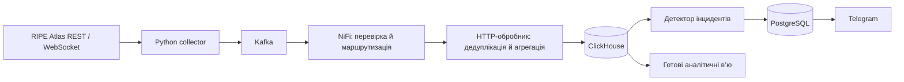

# RIPE Atlas Monitoring

Потокова система моніторингу мережі за відкритими вимірюваннями українських зондів RIPE Atlas. Проєкт збирає RTT, втрати пакетів і події підключення, зберігає історію, формує аналітичні зрізи та надсилає Telegram-сповіщення.

## Повна документація: від структури до запуску

1. **[Усі папки й файли](docs/FILES_REFERENCE.md)** — призначення кожного файла, основні інтерфейси модулів, допоміжні та локальні об’єкти.
2. **[Повний аналіз проєкту](docs/PROJECT_ANALYSIS.md)** — архітектура, контракт події, ролі Python/Kafka/NiFi, відновлення, агрегація, правила інцидентів та межі реалізації.
3. **[Усі таблиці та в’ю](docs/DATABASE_REFERENCE.md)** — 62 об’єкти двох СУБД: призначення, зміст рядка, ключі, зв’язки, типи й пояснення кожного стовпця.
4. **[Повне пояснення кінцевої аналітики](docs/FINAL_ANALYTICS.md)** — KPI, формули та приклади, рівні групування, готові SQL-запити, набір графіків і допустимі висновки.
5. **[Покроковий запуск із нуля](docs/START_HERE.md)** — підготовка ПК, клонування, налаштування, запуск, DBeaver, Telegram, перевірки, оновлення та діагностика.

Додатково: [точні параметри підключення](docs/CONNECTIONS.md), [коротка карта графіків](docs/ANALYTICS_GUIDE.md), [словник KPI](docs/KPI_DICTIONARY.md), [результат перевірки пакета](docs/VALIDATION.md). У [schema_reference.json](docs/schema_reference.json) збережено лише метадані схеми, без вимірювань і даних підписників.

Нижче — короткий огляд. Для послідовного встановлення використовуйте повну покрокову інструкцію з пункту 5.



## Що реалізовано

- REST-дозавантаження та живий WebSocket-потік; відбір зондів країни UA.
- Чотири незалежні комбінації цілі та протоколу: K-root і F-root, IPv4 та IPv6.
- Kafka з підтвердженням запису, повторним читанням і окремим потоком відхилених записів.
- Три гілки NiFi: вимірювання, довідник зондів та події підключення. Потік створюється скриптом.
- Перевірка пакетів, RTT, IP-версії та ідентифікаторів. Повторні події не збільшують агрегати.
- Зберігання сирих даних 5 годин, погодинних — 48 годин, поденних — безстроково.
- Виявлення повторних втрат, підвищеної затримки, відключень і масових підозрілих змін.
- Стійкий стан інциденту та підтвердження відновлення новими даними.
- Підписка на Telegram через `/start`, відписка `/stop`, стан `/status`.
- 20 аналітичних в’ю ClickHouse і 5 операційних в’ю PostgreSQL.

Готовий вебдашборд у цьому репозиторії ще не реалізований. В’ю підготовлені для підключення BI та побудови графіків.

## Вимоги

Docker Desktop / Docker Engine з Compose v2, Python 3.10+ для початкового налаштування та Git. Залежності застосунку встановлюються всередині Docker. Рекомендовано виділити Docker щонайменше 8 ГБ оперативної пам’яті. Для роботи потрібний доступ до RIPE Atlas і Docker Hub.

## Запуск з нуля

```bash
git clone https://github.com/uneavk/ripe-atlas-monitoring.git
cd ripe-atlas-monitoring
python tools/bootstrap.py
```

У Windows, якщо команда `python` недоступна, використовуйте `py -3 tools/bootstrap.py`. Docker Desktop має бути запущений у режимі Linux containers.

Скрипт створить локальний `.env` із випадковими паролями, збере образ застосунку, запустить контейнери, дочекається NiFi, налаштує потік і створить аналітичні в’ю. Початкове завантаження образів та запуск NiFi можуть тривати кілька хвилин. Потім перевірте:

```bash
docker compose ps
docker compose logs --tail 30 collector
docker compose logs --tail 30 analytics
```

Під час першого запуску збирач дозавантажує останню годину, після чого підключає WebSocket. Кількість IPv6-зондів може бути меншою за IPv4. Поточний стан кожного джерела видно у `analytics.data_freshness`.

Повторний запуск `python tools/bootstrap.py` використовує наявні `.env` і Docker-томи. Якщо вручну редагували потік NiFi, збережіть його експорт перед повторним налаштуванням. Для щоденного запуску достатньо:

```bash
docker compose up -d
```

Зупинка зі збереженням даних:

```bash
docker compose stop
```

`docker compose down` також зберігає іменовані томи. Параметр `-v` видаляє їх разом із даними — він не потрібний для звичайного перезапуску.

## Підключення

Облікові дані зберігаються у вашому `.env`. Цей файл не входить до Git.

| Сервіс | Адреса на комп’ютері запуску | Користувач / база |
|---|---|---|
| ClickHouse, DBeaver | localhost:8123, драйвер ClickHouse | CLICKHOUSE_USER, база analytics або monitoring |
| PostgreSQL, DBeaver | localhost:5432, драйвер PostgreSQL | POSTGRES_USER, база POSTGRES_DB, схема reporting |
| NiFi | https://localhost:8443/nifi | NIFI_USERNAME / NIFI_PASSWORD |
| Kafka UI | http://localhost:8080 | Перегляд тем і груп споживачів |
| Adminer | http://localhost:8081 | PostgreSQL; сервер postgres, значення з .env |

NiFi використовує локально створений сертифікат, тому браузер може показати попередження. Докладні кроки DBeaver, адреси всередині Docker, підключення з іншого ПК і обмеження віддаленого доступу: [CONNECTIONS.md](docs/CONNECTIONS.md).

## Де IPv4 та IPv6

У таблицях `monitoring.ping_results`, `hourly_metrics` і `daily_metrics` поле `af` дорівнює 4 або 6. У готових в’ю воно відображається як `ip_version` із назвами IPv4/IPv6. `measurement_id` визначає вимірювання й ціль:

| measurement_id | Ціль | Протокол |
|---|---|---|
| 1001 | K-root | IPv4 |
| 2001 | K-root | IPv6 |
| 1004 | F-root | IPv4 |
| 2004 | F-root | IPv6 |

IPv4 та IPv6 однієї цілі не об’єднуються. Поля `ipv4_provider_asn` та `ipv6_provider_asn` містяться у довіднику зондів. У вимірюваннях `provider_asn` відповідає конкретному протоколу. Подіям відключення зонда окрема IP-версія не приписується.

## Готові графіки на основі в’ю

У ClickHouse відкрийте базу `analytics` → Views:

| В’ю | Призначення |
|---|---|
| measurements_live | Сирі результати останніх 5 годин зі зрозумілими назвами |
| network_5minutes / providers_5minutes | Поточний стан інтервалами по 5 хвилин |
| network_hourly / network_daily | Погодинна та поденна динаміка |
| providers_hourly / providers_daily | Порівняння ASN за ціллю та протоколом |
| probes_hourly / probes_daily | Динаміка конкретного зонда |
| *_kpi | Один показник на рядок: назва, одиниця та числове значення |
| measurement_directory / probe_directory / kpi_directory | Довідники |
| data_freshness | Наявність і давність даних за кожним джерелом |
| probe_events_live | Події підключення та відключення |

```sql
SELECT period_start, target_name, ip_version, avg_rtt_ms, packet_loss_pct
FROM analytics.network_hourly
ORDER BY period_start, target_name, ip_version;
```

Вісь X — `period_start`, вісь Y — обраний числовий KPI, серії — `target_name` та `ip_version`. Для провайдерів додайте `provider_name`. Формул як стовпців у в’ю немає. Подробиці: [ANALYTICS_GUIDE.md](docs/ANALYTICS_GUIDE.md), [KPI_DICTIONARY.md](docs/KPI_DICTIONARY.md).

PostgreSQL містить лише операційні дані. Схема `reporting` включає `incidents`, `incidents_hourly`, `incidents_daily`, `processing_errors_hourly` та `telegram_deliveries_daily`.

## Правила зберігання та агрегування

Сирі дані зберігаються 5 годин. Погодинні накопичувачі оновлюються під час запису, а завершені години доступні у в’ю протягом 48 годин. Після 04:00 за Europe/Kyiv попередня доба агрегується й зберігається безстроково. Перед видаленням старих годин обробник перевіряє збереження поденного результату. Після простою потрібні підсумки дозавершуються.

Кількість пакетів і вимірювань підсумовується. Втрата пакетів розраховується зі співвідношення загальних сум, RTT — із суми затримок та кількості валідних серій. Мінімум і максимум зберігають свої операції. NULL у RTT означає відсутність валідної відповіді. Денна кількість зондів рахується DISTINCT, а не сумою годинних значень.

Згортання й очищення виконує HTTP-обробник після заливки та часовий обробник. Materialized views фіксують маркери вставки; самі по собі вони не виконують повну агрегацію. Прямий INSERT у таблиці ClickHouse обходить контрольований обробник, тому для потоку використовується NiFi → analytics:8082.

Правило 5 годин стосується сирих таблиць БД. Kafka зберігає повідомлення довше для повторного читання: raw — 7 днів, довідник і статуси — 14 днів, відхилені записи — 30 днів.

## Telegram

За замовчуванням токен відсутній: збір і детекція працюють без розсилки. Для власного бота:

```bash
python tools/configure_telegram.py
docker compose restart alerts
```

Введіть токен BotFather у прихованому запиті, потім надішліть боту `/start`. Токен збережеться тільки у `.secrets/telegram/config.json`. Не публікуйте його та не використовуйте один бот одночасно у двох запущених копіях системи: вони конкуруватимуть за getUpdates.

Сповіщення містять тип проблеми, зонд/ASN, ціль, протокол і час. Дві окремі серії підтверджують втрату понад 50%; остання має бути свіжою. HIGH_RTT порівнює дві серії з історичною нормою за тим самим зондом, вимірюванням та протоколом. Відключення підтверджується подією RIPE старшою за 2 хвилини без новішого ping. Відновлення потребує нових свідчень. Масові спрацювання — підозри за вибіркою зондів, а не доведена аварія всього провайдера чи регіону.

## Перевірки

```bash
docker compose run --rm --no-deps analytics python -m unittest discover -s tests -p "test_*.py"
```

Тести перевіряють нормалізацію, правила інцидентів і відновлення, безпечний повтор запису після часткової помилки, добове згортання та часову межу 04:00. Вони не надсилають Telegram-повідомлень.

Перевірити запити до всіх аналітичних в’ю та звірити поденні підсумки зі сховищем:

```bash
python tools/verify_analytics_views.py
```

У щойно запущеній системі поденної історії ще може не бути; вона з’явиться після добового згортання.

## Структура репозиторію

```text
collector/app/       збір, обробник, детектор, Telegram, генерація в’ю
collector/tests/     автоматичні перевірки
clickhouse/init/    початкова схема вимірювань і агрегатів
postgres/init/      початкова операційна схема
nifi/               відтворюване налаштування потоку через REST API
tools/              запуск, налаштування Telegram та перевірки
docs/               підключення, модель даних, KPI й аналітика
compose.yaml        повний Docker-стек
.env.example        шаблон налаштувань без секретів
```

Репозиторій містить вихідний код і схеми. Особисті налаштування, Telegram-підписники, локальні БД, журнали та резервні копії до нього не входять. На новому комп’ютері система збирає власні дані; GitHub не запускає бази замість Docker.
