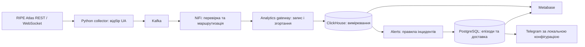

# RIPE Atlas Monitoring

Потоковий моніторинг українських зондів RIPE Atlas: затримка RTT, втрати пакетів, IPv4/IPv6, погодинна й поденна історія, інциденти та **три готові дашборди Metabase**. Інфраструктура відтворюється через Docker Compose.

## Запуск із нуля

Потрібні Git, Python 3.10+ та запущений Docker Desktop у режимі Linux containers. Рекомендовано щонайменше 8 ГБ RAM для Docker. Перший запуск завантажує образи й може тривати кілька хвилин.

```bash
git clone https://github.com/uneavk/ripe-atlas-monitoring.git
cd ripe-atlas-monitoring
python tools/bootstrap.py
```

У Windows можна використати `py -3` замість `python`. Bootstrap генерує локальні паролі, створює схеми, збирає спільний образ застосунку, запускає сервіси, налаштовує NiFi, аналітичні в’ю та Metabase. Повторний bootstrap оновлює власні налаштування; щоденний запуск не потребує перебудови образів.

## Де подивитися аналітику

Відкрийте **[Metabase](http://localhost:3000)**. Логін: `admin@ripe.local`. Особистий випадково створений пароль міститься у локальному `.secrets/metabase/admin.json`, поле `password`.

Колекція **RIPE Atlas · Лабораторна СТП**:

| Дашборд | Зміст |
|---|---|
| 01 · Поточний стан мережі | Свіжість чотирьох джерел, RTT, втрати, покриття, карта та останні результати |
| 02 · Історія та провайдери | Завершені години, дні, зрізи ASN і відхилення зондів |
| 03 · Інциденти та якість потоку | Відкриті епізоди, журнал, діагностика відхилень та статуси доставки |

Ідентифікатори дашбордів створюються автоматично й можуть відрізнятися між інсталяціями. Точні локальні посилання зберігаються у `.secrets/metabase/manifest.json`. Докладно: **[METABASE.md](docs/METABASE.md)**.


Скріншот і `artifacts/evidence_snapshot.json` є історичними доказами роботи від 09.11.2026, а не поточним статусом мережі. Нове встановлення починається без цих вимірювань у БД.

## Рух даних



Ping виконує RIPE Atlas. Python отримує результати через API. Kafka буферизує їх, NiFi перевіряє та маршрутизує. Потік записується в ClickHouse; PostgreSQL веде транзакційний стан інцидентів. Metabase має окрему службову PostgreSQL-БД для своїх налаштувань.

## Джерела, KPI та зберігання

| Measurement ID | Ціль | Протокол |
|---|---|---|
| 1001 / 2001 | K-root | IPv4 / IPv6 відповідно |
| 1004 / 2004 | F-root | IPv4 / IPv6 відповідно |

`af=4` означає IPv4, `af=6` - IPv6. У готових в’ю це `ip_version`. ASN IPv4 та IPv6 зонда можуть відрізнятися. Цілі й протоколи не змішуються.

| Рівень | Правило |
|---|---|
| Сирі результати | Останні 5 годин |
| Завершені години | 48 годин із захистом незбереженого дня |
| Поденні дані | Попередня київська доба фіналізується після 04:00, дні не видаляються |

Накопичувач години оновлюється на кожну подію. Згортання й очищення виконує обробник після заливки та за часом. SQL materialized views фіксують вставки, але не є самостійним годинником. Перед очищенням годин підтверджується запис денного підсумку.

Втрати = відношення сум пакетів, RTT = сума середніх RTT серій / кількість коректних серій, мінімум = MIN, максимум = MAX, зонди = DISTINCT за цілим періодом. RTT без відповіді залишається NULL. **[Словник KPI](docs/KPI_DICTIONARY.md)** пояснює кожну формулу та знаменник.

## Адреси та облікові дані

| Сервіс | Типова адреса | Де взяти доступ |
|---|---|---|
| Metabase | http://localhost:3000 | `.secrets/metabase/admin.json` |
| ClickHouse / DBeaver | localhost:8123 | `CLICKHOUSE_USER` / `CLICKHOUSE_PASSWORD` у `.env` |
| PostgreSQL / DBeaver | localhost:5432 | `POSTGRES_USER` / `POSTGRES_PASSWORD` / `POSTGRES_DB` у `.env` |
| NiFi | https://localhost:8443/nifi | `NIFI_USERNAME` / `NIFI_PASSWORD` у `.env` |
| Kafka UI | http://localhost:8080 | Локальний огляд Kafka |
| Adminer | http://localhost:8081 | Сервер `postgres`, облікові дані PostgreSQL з `.env` |

Порти можна змінити у `.env`. `localhost` означає комп’ютер запуску. GitHub зберігає код і конфігурації, але не запускає ці БД. Доступ з іншої мережі потребує окремого мережевого налаштування: [CONNECTIONS.md](docs/CONNECTIONS.md).

Робочі паролі та Telegram-токен залишаються локально. До Git входить `.env.example` із заглушками. Bootstrap створює різні паролі для кожної інсталяції. Не підміняйте наявний `.env` шаблоном: зміна пароля у файлі не змінює пароль уже ініціалізованого тому БД.

## Щоденна робота та перевірки

```bash
docker compose up -d
docker compose ps
docker compose logs --tail 30 collector analytics
```

Зупинка зі збереженням даних: `docker compose stop`. Не використовуйте `down -v` для звичайного перезапуску: це видаляє томи з даними.

```bash
python tools/run_checks.py
python tools/check_publication.py
python tools/verify_analytics_views.py
python tools/verify_metabase.py
```

Перші дві команди перевіряють локальний код і файли публікації. Для `run_checks.py` встановіть залежності: `python -m pip install -r collector/requirements.txt`. Дві останні команди потребують запущеного та налаштованого Docker-стека. Порожня денна історія у новій БД очікувана до першої фіналізації. Тести не надсилають повідомлень.

Telegram необов’язковий: `python tools/configure_telegram.py` приховано збереже власний токен у `.secrets/telegram/config.json`. Після підключення й перезапуску alerts приватні користувачі підписуються через `/start`, відписуються через `/stop`. Нові інциденти можуть надсилатися активним адресатам, тому для перевірок коду бот не потрібний.

## Структура та документація

| Папка | Призначення |
|---|---|
| `collector/app/` | Спільний код collector, analytics та alerts |
| `collector/tests/`, `bi/test_dashboards.py` | 37 прикладних та 4 BI-тести |
| `clickhouse/`, `postgres/` | Початкові схеми та SQL-знімки в’ю |
| `nifi/` | Відтворюваний потік NiFi через API |
| `bi/` | SQL-картки, візуальні налаштування й публічний експорт трьох дашбордів |
| `tools/` | Запуск, налаштування BI, перевірки та генерація документації |
| `docs/` | Повні пояснення архітектури, файлів, БД, KPI та запуску |
| `artifacts/` | Історичні скріншоти й контрольний зріз без паролів |
| `.env`, `.secrets/` | Локальні дані доступу, виключені з Git |

Почати з **[покрокової інструкції](docs/START_HERE.md)**. Далі: [усі файли](docs/FILES_REFERENCE.md), [архітектура](docs/PROJECT_ANALYSIS.md), [усі таблиці та стовпці](docs/DATABASE_REFERENCE.md), [кінцева аналітика](docs/FINAL_ANALYTICS.md), [Metabase](docs/METABASE.md), [перевірки](docs/VALIDATION.md), [порядок супроводу](docs/MAINTENANCE.md).

Система працює на одному Docker-хості. Зонди є вибіркою, а аномалії - підозрами щодо шляху до конкретної цілі. Глобальна exactly-once транзакція між Kafka, двома БД і Telegram не заявляється.
