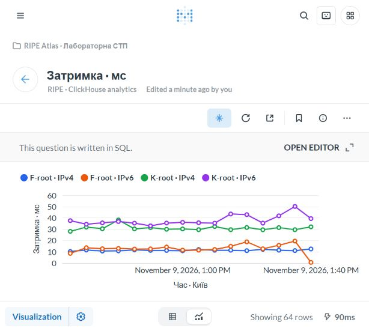
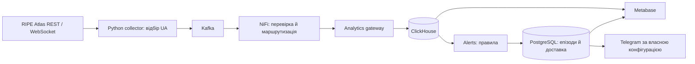

# RIPE Atlas Monitoring

Потоковий моніторинг українських зондів RIPE Atlas: RTT, втрати пакетів, IPv4/IPv6, історія, інциденти та 3 дашборди Metabase. Усі сервіси розгортаються через Docker Compose.

## Запуск

Потрібні Git, Python 3.10+ та Docker Desktop із Linux containers. Рекомендовано щонайменше 8 ГБ RAM для Docker.

```bash
git clone https://github.com/uneavk/ripe-atlas-monitoring.git
cd ripe-atlas-monitoring
python tools/bootstrap.py
```

Репозиторій приватний: потрібний дозволений GitHub-акаунт. Bootstrap генерує локальні паролі, створює схеми й аналітику, налаштовує NiFi та Metabase. Нове встановлення починається без вимірювань і збирає їх із RIPE. [Повний запуск і відновлення налаштувань](docs/SETUP.md).

## Де подивитися аналітику

Відкрийте **http://localhost:3000**, увійдіть як **admin@ripe.local**. Пароль міститься у локальному `.secrets/metabase/admin.json`, поле `password`. Якщо METABASE_PORT змінено, використайте свій порт. У колекції **RIPE Atlas · Лабораторна СТП**:

| Дашборд | Зміст |
|---|---|
| 01 · Поточний стан мережі | Свіжість, RTT, втрати, зонди й карта |
| 02 · Історія та провайдери | Завершені години, дні та зрізи ASN |
| 03 · Інциденти та якість потоку | Епізоди, помилки обробки й доставки |

Локальні ID й посилання зберігаються у .secrets/metabase/manifest.json. [Джерела й пояснення кожної з 26 карток](docs/ANALYTICS.md#dashboard-cards).



Скріншоти та artifacts/evidence_snapshot.json є історичними доказами роботи, а не поточним станом мережі.

## Рух даних



Ping виконує RIPE Atlas. Система отримує результати через API. ClickHouse зберігає вимірювання й агрегати, PostgreSQL - транзакційний стан інцидентів. Metabase має окрему службову БД.

| Measurement | Ціль | Протокол |
|---|---|---|
| 1001 / 2001 | K-root | IPv4 / IPv6 відповідно |
| 1004 / 2004 | F-root | IPv4 / IPv6 відповідно |

Сирі дані зберігаються 5 годин, завершені години - 48 годин, дні - безстроково. Після 04:00 Europe/Kyiv фіналізується попередня доба. Обробник виконує очищення після заливки та за часом, спочатку підтверджує денний запис. Цілі й протоколи не змішуються.

## Шість інструкцій

| Документ | Що містить |
|---|---|
| [SETUP.md](docs/SETUP.md) | Запуск, усі параметри й порти, DBeaver, Metabase, Telegram, онлайн-копія паролів, супровід |
| [ARCHITECTURE.md](docs/ARCHITECTURE.md) | Компоненти, контракти, Kafka/NiFi, зберігання, правила інцидентів та гарантії |
| [ANALYTICS.md](docs/ANALYTICS.md) | Формули, групування, словник усіх KPI, SQL-приклади та кожна картка дашбордів |
| [DATABASE.md](docs/DATABASE.md) | Усі 62 прикладні таблиці/в’ю та 599 стовпців із типами й поясненнями |
| [FILES.md](docs/FILES.md) | Призначення кожної папки, кожного файла та основних інтерфейсів коду |
| [CHECKS.md](docs/CHECKS.md) | Дати, результати перевірок і межі підтверджених результатів |

Машиночитані дані: [словник KPI у CSV](docs/KPI_DICTIONARY.csv), [метадані схеми](docs/schema_reference.json), [експорт дашбордів](bi/dashboard_spec.json). NiFi відтворюється скриптом nifi/build_pipeline.py.

## Структура

```text
collector/app/        збирач, обробник, інциденти та сповіщення
collector/tests/      тести прикладної логіки
clickhouse/init.sql  єдина початкова схема ClickHouse
postgres/init.sql    єдина початкова схема PostgreSQL
nifi/                API-клієнт і конфігуратор потоку
bi/                  специфікація, експорт і тести дашбордів
tools/               запуск, документація та перевірки
docs/                шість інструкцій, словник CSV й метадані БД
artifacts/           датовані докази роботи
.github/workflows/   CI та ручне відновлення конфігурації
```

## Команди перевірки та супроводу

```bash
python -m pip install -r collector/requirements.txt
python tools/checks.py
python tools/docs.py
```

checks.py об’єднує 41 модульний тест, перевірку документації та файлів коміту. Можна обрати `--unit`, `--docs` або `--publication`. docs.py оновлює довідники, словник KPI та експорт аналітики. Для актуалізації метаданих працюючих БД: `python tools/docs.py --schema`. Для інтеграційних перевірок залишені verify_analytics_views.py і verify_metabase.py.

Щоденний запуск: `docker compose up -d`. Зупинка зі збереженням даних: `docker compose stop`. Файли доступу читаються локально. Погоджена копія .env і трьох файлів Metabase збережена в GitHub Secrets; її завантаження описане в SETUP. Telegram-токен до неї не включений.

GitHub зберігає код і конфігурації. Вимірювання, історія та черги містяться у Docker-томах. Система працює на одному Docker-хості, а зонди є вибіркою мережі.
