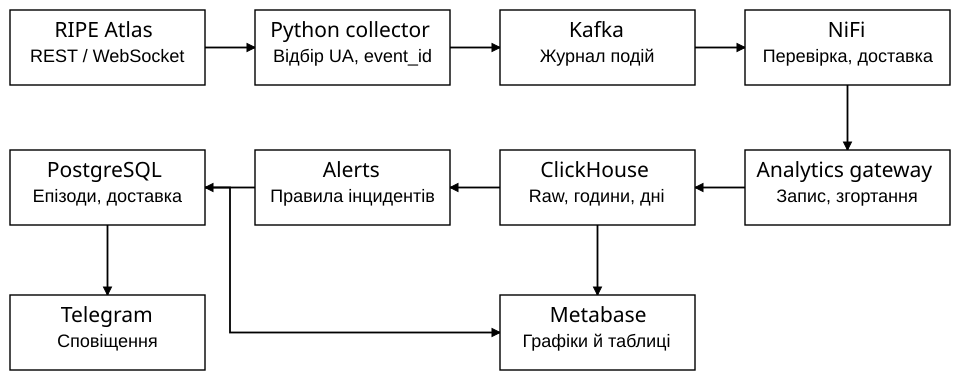
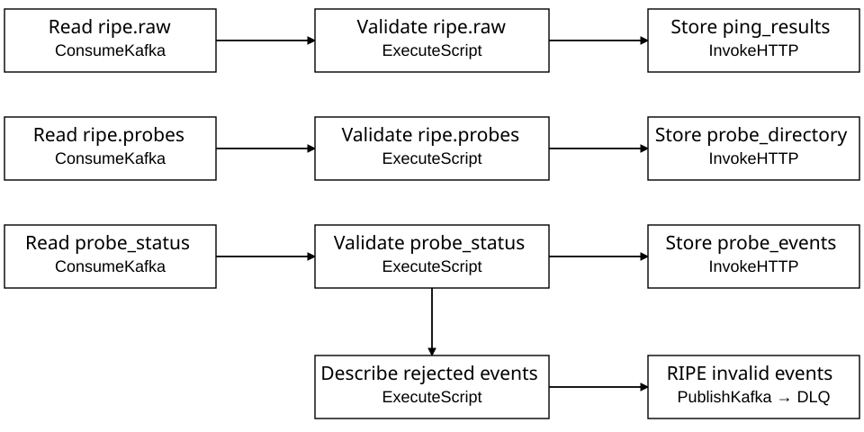

# Матеріали для захисту лабораторної СТП

**Тема:** потоковий моніторинг мережі України за даними RIPE Atlas. **Група:** СМПР-1.

**Команда:** Недоступ Яна, Хілько Вікторія, Трохимчук Валерія.

Контрольний зріз і 16 власних скріншотів датовані **16.11.2026**. Це докази конкретного запуску, а не поточний стан мережі та не початкові дані нової інсталяції.

## Що відкривати

| Файл | Призначення |
|---|---|
| [RIPE_Atlas_Report.pdf](RIPE_Atlas_Report.pdf) | Звіт на 18 сторінках: задача, підхід, запуск, файли, сховища, згортання, KPI, інциденти, графіки, перевірки та джерела. Містить 16 реальних скріншотів. |
| [RIPE_Atlas_Defense.pptx](RIPE_Atlas_Defense.pptx) | 15 слайдів для спільного виступу. Заголовки, текст і таблиці редагуються. У нотатках кожного слайда є пояснення та першоджерела. |
| [demo_clickhouse.sql](demo_clickhouse.sql) | 13 демонстраційних запитів: структура, IPv4/IPv6, години, дні, назви KPI, маркери вставок, перевірка raw та штучні приклади лише в SELECT. |
| [demo_postgres.sql](demo_postgres.sql) | 5 запитів до операційної БД: структура, епізоди, нові інциденти, відхилення та стани доставки. Адресатів Telegram не показує. |
| [verification.json](verification.json) | Знеособлений контрольний зріз БД, станів контейнерів і конфігурації NiFi. Без паролів, chat_id і сирих мережевих подій. |
| [screenshots/](screenshots/) | 16 оригіналів скріншотів для збільшення та перевірки. У PDF деякі зображення показані фрагментами без порожніх полів. |
| [architecture.svg](architecture.svg), [nifi-flow.svg](nifi-flow.svg) | Схема всього проєкту та основних гілок NiFi. |
| Цей README | Порядок показу, рекомендований розподіл виступу й відповіді на типові запитання. |

У звіті є дві окремі схеми та справжні екрани NiFi: повне полотно і Summary з усіма 11 процесорами Running. Опис пов’язує запуск, проходження події, зберігання, правила помилок і читання графіків. Авторський текст чорний; оригінальні екрани зберігають кольори програм.



У ClickHouse надходять вимірювання, у PostgreSQL зберігаються епізоди та доставка. Стрілка від PostgreSQL до Telegram означає читання черги прикладним відправником. База сама не викликає Telegram API.



На схемі NiFi показано основний маршрут і спільну діагностику. Повний потік має 21 з’єднання: відхилення з усіх гілок та повтори HTTP показані на справжньому полотні. SVG-файли можна збільшувати без втрати різкості.

## Запуск і відкриття інтерфейсів

Новий незалежний стенд:

```bash
git clone https://github.com/uneavk/ripe-atlas-monitoring.git
cd ripe-atlas-monitoring
python tools/bootstrap.py
```

Репозиторій приватний, тому GitHub-акаунт має отримати доступ. Bootstrap створює випадкові локальні паролі та налаштовує Docker, NiFi, аналітичні в’ю і Metabase. Інсталяція починає збирати власні вимірювання; вона не отримує історію з PDF або скріншотів.

Для вже налаштованого стенда:

```bash
docker compose up -d
docker compose ps -a
```

| Інтерфейс | Стандартна адреса | Де взяти доступ |
|---|---|---|
| Metabase | http://localhost:3000 | admin@ripe.local, пароль у `.secrets/metabase/admin.json`, поле `password`. |
| Kafka UI | http://localhost:8080 | Локальний огляд тем і споживачів. |
| NiFi | https://localhost:8443/nifi | `NIFI_USERNAME` і `NIFI_PASSWORD` у `.env`. |
| DBeaver → ClickHouse | localhost:8123 | База `monitoring`, `CLICKHOUSE_USER` / `CLICKHOUSE_PASSWORD` із `.env`. |
| DBeaver → PostgreSQL | localhost:5432 | `POSTGRES_DB`, `POSTGRES_USER` / `POSTGRES_PASSWORD` із `.env`. |

Якщо порти змінені, використати значення своєї інсталяції. Пароль із `.env` іншого незалежного стенда не підходить. Паролі не потрібно показувати на екрані під час виступу. Ідентифікатори дашбордів зберігаються в `.secrets/metabase/manifest.json` та можуть відрізнятися між встановленнями.

Повний порядок установлення, підключення DBeaver та відновлення погодженої онлайн-копії конфігурації: [SETUP.md](../../docs/SETUP.md). Звичайна зупинка зі збереженням даних: `docker compose stop`.

## Порядок живої демонстрації

1. **Docker Desktop:** відкрити проєкт, показати працюючі служби. `kafka-init: Exited (0)` є очікуваним завершенням одноразового налаштування.
2. **Kafka UI → Topics / Consumers:** показати `ripe.raw`, `ripe.probes`, `ripe.probe_status`, `ripe.dead_letter` та окремі групи NiFi/діагностики. Порожня успадкована `ripe.validated` поточному потоку не потрібна. `STABLE` характеризує членство у групі; `N/A` не означає нуль lag.
3. **NiFi:** показати три гілки Read → Validate and transform → Store та маршрут відхилених подій. Не переналаштовувати й не зупиняти потік заради показу.
4. **DBeaver / ClickHouse:** відкрити `demo_clickhouse.sql`. Виділяти один запит і натискати **Ctrl+Enter**. Почати зі структури та `data_freshness`, далі показати `network_hourly`, `network_daily`, `*_kpi`, `SHOW CREATE` та `retention_runs`.
5. **DBeaver / PostgreSQL:** відкрити `demo_postgres.sql` в окремому підключенні. Показати епізоди, їх відновлення, причини відхилень і стани доставки.
6. **Metabase:** у колекції RIPE Atlas відкрити поточний стан, історію/провайдерів та інциденти/якість потоку. На карті обрати 2001 для K-root IPv6. Зіставити останню завершену годину з SQL, перевіряючи однаковий час, ціль і протокол.

Обидва демонстраційні SQL-файли лише читають дані. Початкову схему створюють `clickhouse/init.sql` і `postgres/init.sql` під час ініціалізації нових Docker-томів. Готові в’ю встановлює bootstrap через `app.install_kpi`, `app.analytics_views` та `app.operational_views`. Демонстраційні файли не замінюють ці кроки.

## Штучні приклади та перевірки

У кінці `demo_clickhouse.sql` є два пояснювальні SELECT. Вони не вставляють записи, не змінюють годинник і не надсилають повідомлень.

| Приклад | Очікуваний результат |
|---|---|
| Втрачено 3 із 3 пакетів та 0 із 9 | Загальні втрати 25%. |
| 100 серій по 10 мс та 1 по 100 мс | Середня RTT ≈10,89 мс. |
| A,B в одній годині, B,C у наступній | 3 різні зонди за весь період. |
| Час 16.11.2026 03:59:59 за Києвом | Остання дата, яку вже можна фіналізувати: 14.11.2026. |
| Час 16.11.2026 04:00:00 за Києвом | Остання дата, яку вже можна фіналізувати: 15.11.2026. |

Ці SELECT пояснюють розрахунок. Реальну поведінку `Store.maintenance()`, повторів і відновлення після невдалого запису перевіряють тести:

```bash
python -m pip install -r collector/requirements.txt
python tools/checks.py
python tools/verify_analytics_views.py
python tools/verify_metabase.py
```

`checks.py` виконує 37 прикладних та 4 BI-тести, перевіряє документацію і файли коміту. Інтеграційні перевірки потребують працюючого стека. Ці перевірки не створюють тестових Telegram-інцидентів.

## Рекомендований розподіл виступу

Це пропозиція для рівного часу виступу, а не розподіл авторства програмних модулів.

| Учасниця | Слайди | Що показати | Орієнтир часу |
|---|---|---|---|
| Недоступ Яна | 1–5 | Задача, джерела, загальна архітектура, запуск Docker, Kafka. | 3 хв |
| Хілько Вікторія | 6–10 | NiFi, ClickHouse, зберігання, KPI, PostgreSQL та інциденти. | 3 хв |
| Трохимчук Валерія | 11–15 | Графіки, історія, карта IPv6, перевірки, Git та висновки. | 3 хв |

Нотатки спікера містяться всередині PPTX: відкрити область **Нотатки / Notes** або режим доповідача PowerPoint. Учасниці можуть помінятися блоками, зберігаючи участь усіх трьох.

**Початок, Яна.** Ми моніторимо українські зонди RIPE Atlas. Зонди виконують ping до K-root і F-root окремо через IPv4 та IPv6. Наша система отримує готові результати через API, перевіряє події та формує історію мережевих показників. Python працює зі специфікою RIPE, Kafka буферизує події, NiFi керує їх доставкою. Стенд відтворюється однією командою bootstrap. На екрані Kafka видно незалежні теми й споживачів, тому збір не прив’язаний до швидкості побудови графіка.

**Обробка, Вікторія.** NiFi має три гілки: ping, довідник і статуси зондів. Коректні події проходять у шлюз, тимчасові збої повторюються, а відхилення отримують причину в окремій темі. ClickHouse зберігає сирі події за 5 годин, погодинні підсумки за 48 годин і постійні денні агрегати. Денний підсумок фіналізується після 04:00 за Києвом. Для цього працюють маркери вставок і часовий обробник. Відсотки обчислюються зі співвідношення сум, RTT зважується кількістю валідних серій, зонди рахуються DISTINCT за всім періодом. PostgreSQL веде епізоди проблем та доставку сповіщень.

**Результат, Валерія.** У Metabase підготовлено три дашборди та 26 карток. Поточний стан показує свіжість, RTT, втрати й зонди, історія дає завершені години та дні, операційна панель пояснює епізоди і помилки. На карті обрано K-root IPv6, тобто measurement 2001. Точки є зондами, а не оцінкою покриття населення. У звіті є контрольний SQL-зріз і результати перевірок, код та переносимі налаштування збережені в Git. Ми отримали відтворюваний лабораторний стенд і враховуємо його межі: один хост, нерівномірну вибірку та необхідність перевіряти масштабні підозри незалежно.

## Типові запитання

| Запитання | Коротка відповідь |
|---|---|
| Навіщо Python перед Kafka? | Пагінація RIPE, WebSocket, відбір UA, нормалізація, event_id та відновлення позиції. |
| Навіщо Kafka разом із NiFi? | Kafka зберігає журнал/позиції, NiFi керує гілками перетворення, чергами та HTTP-повторами. |
| Де ping: PostgreSQL чи ClickHouse? | У ClickHouse. PostgreSQL зберігає операційний стан інцидентів і доставки. |
| Чи є справжній SQL-тригер на 04:00? | Materialized views спрацьовують на INSERT і пишуть маркери. Часові умови виконує `Store.maintenance()` після запису та за таймером. |
| Чому не середнє годинних середніх? | Години можуть мати різну кількість серій. Потрібні суми та лічильники як ваги. |
| Де IPv6? | `af=6` у raw, `ip_version='IPv6'` у в’ю, окремі `asn_v6` у довіднику, ID 2001/2004. |
| Чи кожна червона точка є інцидентом? | Одиничний результат потребує перевірки повторів. Детектор має власні пороги й мінімальні вибірки. |
| Чи система гарантує exactly-once скрізь? | Ні. Транспорт допускає повтори, шлюз має event_id і журнал відновлення. Загальної транзакції між усіма службами немає. |

## Оригінали скріншотів

| Зображення | Що підтверджує |
|---|---|
| [Docker](screenshots/01-docker-live.jpg) | Служби та публікації collector. |
| [GitHub](screenshots/02-github-structure.jpg) | Структура й команди перевірки. |
| [Теми Kafka](screenshots/03-kafka-topics.jpg) | Теми, лічильники, успадкована порожня тема. |
| [Споживачі Kafka](screenshots/04-kafka-consumers.jpg) | Окремі групи NiFi та діагностики. |
| [ClickHouse](screenshots/05-dbeaver-clickhouse-views.jpg) | Фізичні таблиці та каталог в’ю. |
| [IPv4/IPv6](screenshots/06-dbeaver-ip-versions.jpg) | Чотири джерела, давність і спостережувані зонди. |
| [Очищення](screenshots/07-dbeaver-retention.jpg) | Маркери INSERT, last_maintenance і нуль старих raw. |
| [KPI](screenshots/08-dbeaver-kpi.jpg) | Назви, одиниці та значення готових KPI. |
| [RTT](screenshots/09-metabase-rtt.jpg) | Поточні п’ятихвилинні лінії чотирьох джерел. |
| [Дні](screenshots/10-metabase-daily.jpg) | Постійна поденна історія. |
| [Карта IPv6](screenshots/11-metabase-ipv6-map.jpg) | Останні серії measurement 2001, атрибуція OpenStreetMap. |
| [Години](screenshots/12-metabase-hourly.jpg) | Завершені інтервали та пропуски спостережень. |
| [Журнал Metabase](screenshots/13-metabase-incidents.jpg) | Реальні типи й стани епізодів. |
| [PostgreSQL](screenshots/14-dbeaver-postgresql.jpg) | Епізоди, протокол, час і статус сповіщення в DBeaver. |

| [NiFi Summary](screenshots/15-nifi-summary.jpg) | Усі 11 процесорів Running та їхні п’ятихвилинні лічильники. |
| [Полотно NiFi](screenshots/16-nifi-canvas.jpg) | Три гілки та спільний маршрут відхилених подій. |

Повні першоджерела й пояснення наведені у звіті та [аналітичному довіднику](../../docs/ANALYTICS.md). Код і експорти конфігурацій залишаються в основних папках проєкту. Файли захисту не потрібні для роботи контейнерів. Жодних листів або запрошень цим набором не надсилається.
