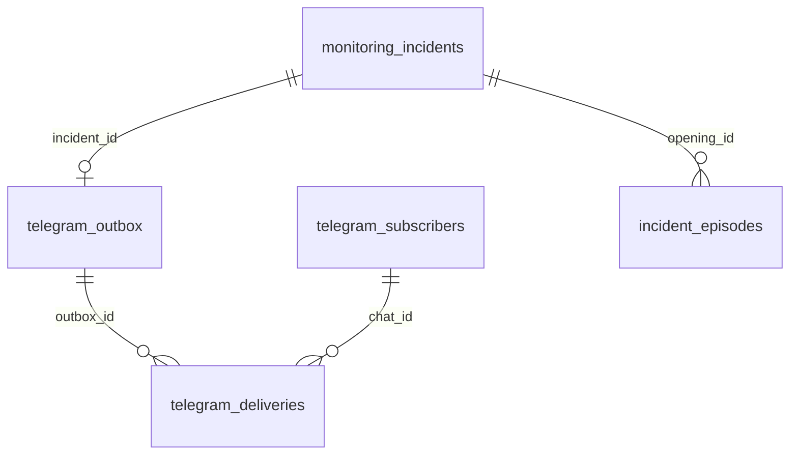

# Повний довідник БД, таблиць і в’ю

[Карта документації](../README.md) · [Кінцева аналітика](FINAL_ANALYTICS.md)

## Відповідальність сховищ

ClickHouse: 8 фізичних таблиць, 2 materialized view та 34 звичайних view (14 сумісних у monitoring і 20 користувацьких у analytics). PostgreSQL: 10 фізичних таблиць, 3 внутрішні view у public та 5 користувацьких у reporting. Разом описано 62 об’єкти. PostgreSQL не приймає мережеві вимірювання перед ClickHouse. View — запит до існуючих даних, а не нова незалежна копія.

## Зв’язки та ключі

У ClickHouse зонд зв’язує довідник і вимірювання через probe_id/prb_id, а measurement_id/msm_id зв’язує результат із ціллю. Ключ години: hour_start+probe_id+msm_id+af+asn; ключ дня: day+ті самі виміри. ReplacingMergeTree логічно вибирає останню версію: фізичне сортування не є реляційним UNIQUE. Для коректного читання використовуються FINAL і дедуплікація шлюзу.

## Індекс усіх об’єктів

| СУБД | Об’єкт | Тип |
|---|---|---|
| ClickHouse | `analytics.data_freshness` | View |
| ClickHouse | `analytics.kpi_directory` | View |
| ClickHouse | `analytics.measurement_directory` | View |
| ClickHouse | `analytics.measurements_live` | View |
| ClickHouse | `analytics.network_5minutes` | View |
| ClickHouse | `analytics.network_daily` | View |
| ClickHouse | `analytics.network_daily_kpi` | View |
| ClickHouse | `analytics.network_hourly` | View |
| ClickHouse | `analytics.network_hourly_kpi` | View |
| ClickHouse | `analytics.probe_directory` | View |
| ClickHouse | `analytics.probe_events_live` | View |
| ClickHouse | `analytics.probes_daily` | View |
| ClickHouse | `analytics.probes_daily_kpi` | View |
| ClickHouse | `analytics.probes_hourly` | View |
| ClickHouse | `analytics.probes_hourly_kpi` | View |
| ClickHouse | `analytics.providers_5minutes` | View |
| ClickHouse | `analytics.providers_daily` | View |
| ClickHouse | `analytics.providers_daily_kpi` | View |
| ClickHouse | `analytics.providers_hourly` | View |
| ClickHouse | `analytics.providers_hourly_kpi` | View |
| ClickHouse | `monitoring.daily_country_metrics` | View |
| ClickHouse | `monitoring.daily_kpi` | View |
| ClickHouse | `monitoring.daily_metrics` | ReplacingMergeTree |
| ClickHouse | `monitoring.daily_network_metrics` | View |
| ClickHouse | `monitoring.daily_probe_activity` | View |
| ClickHouse | `monitoring.daily_provider_kpi` | View |
| ClickHouse | `monitoring.daily_provider_metrics` | View |
| ClickHouse | `monitoring.field_dictionary` | ReplacingMergeTree |
| ClickHouse | `monitoring.hourly_country_metrics` | View |
| ClickHouse | `monitoring.hourly_kpi` | View |
| ClickHouse | `monitoring.hourly_metrics` | ReplacingMergeTree |
| ClickHouse | `monitoring.hourly_network_metrics` | View |
| ClickHouse | `monitoring.hourly_provider_kpi` | View |
| ClickHouse | `monitoring.hourly_provider_metrics` | View |
| ClickHouse | `monitoring.kpi_dictionary` | ReplacingMergeTree |
| ClickHouse | `monitoring.live_network_measurements` | View |
| ClickHouse | `monitoring.ping_ingest_trigger` | MaterializedView |
| ClickHouse | `monitoring.ping_results` | ReplacingMergeTree |
| ClickHouse | `monitoring.probe_directory` | ReplacingMergeTree |
| ClickHouse | `monitoring.probe_events` | ReplacingMergeTree |
| ClickHouse | `monitoring.raw_ping_last_5h` | View |
| ClickHouse | `monitoring.raw_probe_events_last_5h` | View |
| ClickHouse | `monitoring.retention_runs` | ReplacingMergeTree |
| ClickHouse | `monitoring.status_ingest_trigger` | MaterializedView |
| PostgreSQL | `public.incident_episode_metrics` | VIEW |
| PostgreSQL | `public.incident_episodes` | BASE TABLE |
| PostgreSQL | `public.incident_history_metrics` | VIEW |
| PostgreSQL | `public.monitoring_incidents` | BASE TABLE |
| PostgreSQL | `public.notification_cooldowns` | BASE TABLE |
| PostgreSQL | `public.probe_connectivity_state` | BASE TABLE |
| PostgreSQL | `public.processing_error_summary` | VIEW |
| PostgreSQL | `public.processing_errors` | BASE TABLE |
| PostgreSQL | `public.telegram_command_replies` | BASE TABLE |
| PostgreSQL | `public.telegram_deliveries` | BASE TABLE |
| PostgreSQL | `public.telegram_outbox` | BASE TABLE |
| PostgreSQL | `public.telegram_poll_state` | BASE TABLE |
| PostgreSQL | `public.telegram_subscribers` | BASE TABLE |
| PostgreSQL | `reporting.incidents` | VIEW |
| PostgreSQL | `reporting.incidents_daily` | VIEW |
| PostgreSQL | `reporting.incidents_hourly` | VIEW |
| PostgreSQL | `reporting.processing_errors_hourly` | VIEW |
| PostgreSQL | `reporting.telegram_deliveries_daily` | VIEW |

## ClickHouse

### analytics.data_freshness

Один рядок на кожне з 4 налаштованих джерел, навіть без даних. Давність рахується за event_time і охоплює як stream, так і backfill; це не окремий контроль WebSocket.

| Стовпець | Тип | Пояснення |
|---|---|---|
| `measurement_id` | `UInt32` | ID RIPE-вимірювання, що визначає ціль і AF. |
| `target_name` | `String` | Читабельна назва K-root/F-root або резервний підпис measurement. |
| `ip_version` | `String` | Підпис IPv4/IPv6; для неадресних подій у PostgreSQL — Не застосовується. |
| `latest_measurement_at` | `Nullable(DateTime64(3, 'Europe/Kyiv'))` | Час останнього вимірювання джерела за Києвом; NULL без даних. |
| `data_age_seconds` | `Nullable(Int64)` | Давність останнього вимірювання у секундах; NULL, якщо даних немає. |
| `measurements_last_5h` | `UInt64` | Кількість серій у сирій таблиці за останні 5 годин. |
| `probes_observed_last_5h` | `UInt64` | Кількість різних зондів із результатами джерела за останні 5 годин. |
| `data_status` | `String` | Немає даних / Дані застаріли / Дані надходять; поріг старіння — 900 с. |
### analytics.kpi_directory

12 публічних числових KPI: код, назва й одиниця. Частина колонок відсутня у п’ятихвилинних views; точний склад наведено нижче.

| Стовпець | Тип | Пояснення |
|---|---|---|
| `kpi_code` | `String` | Стабільний код KPI. |
| `kpi_name` | `String` | Українська назва KPI в analytics. |
| `unit` | `String` | Одиниця KPI у analytics. |
### analytics.measurement_directory

Чотири визначення ціль+протокол. Один рядок на measurement_id; показує hostname, IP-версію та інтервал 240 с.

| Стовпець | Тип | Пояснення |
|---|---|---|
| `measurement_id` | `UInt32` | ID RIPE-вимірювання, що визначає ціль і AF. |
| `target_name` | `String` | Читабельна назва K-root/F-root або резервний підпис measurement. |
| `target_hostname` | `String` | DNS-ім’я цілі вимірювання. |
| `ip_version` | `String` | Підпис IPv4/IPv6; для неадресних подій у PostgreSQL — Не застосовується. |
| `address_family` | `UInt8` | Числова версія IP у довіднику вимірювань: 4 або 6. |
| `interval_seconds` | `UInt32` | Номінальний інтервал RIPE-вимірювання, тут 240 с. |
### analytics.measurements_live

Одна дедуплікована серія ping за останні 5 годин; явні measurement_id, target_name, ip_version, ASN і координати.

| Стовпець | Тип | Пояснення |
|---|---|---|
| `measured_at` | `DateTime64(3, 'Europe/Kyiv')` | Час вимірювання у часовій зоні Europe/Kyiv. |
| `probe_id` | `UInt32` | ID зонда у довідниках, агрегатах та звітах. |
| `measurement_id` | `UInt32` | ID RIPE-вимірювання, що визначає ціль і AF. |
| `ip_version` | `String` | Підпис IPv4/IPv6; для неадресних подій у PostgreSQL — Не застосовується. |
| `target_name` | `String` | Читабельна назва K-root/F-root або резервний підпис measurement. |
| `destination_address` | `Nullable(String)` | IP-адреса цілі вимірювання. |
| `source_address` | `Nullable(String)` | Адреса, яку RIPE повідомив як джерело вимірювання. |
| `provider_asn` | `UInt32` | ASN відповідного протоколу в готовому звіті. |
| `provider_name` | `String` | Позначення ASномер або Невідомий ASN; не комерційна назва оператора. |
| `country_code` | `LowCardinality(String)` | Зрозуміла назва коду країни. |
| `latitude` | `Nullable(Float64)` | Широта зонда. |
| `longitude` | `Nullable(Float64)` | Довгота зонда. |
| `packets_sent` | `UInt16` | Кількість надісланих пакетів. |
| `packets_received` | `UInt16` | Кількість отриманих відповідей. |
| `packets_lost` | `Int32` | Кількість надісланих пакетів без відповіді. |
| `packet_loss_pct` | `Float32` | Зважені втрати пакетів періоду: зі співвідношення сум. |
| `avg_rtt_ms` | `Nullable(Float32)` | Середня RTT валідних серій, у мс; NULL без відповідей. |
| `min_rtt_ms` | `Nullable(Float32)` | Найменша валідна RTT періоду, мс. |
| `max_rtt_ms` | `Nullable(Float32)` | Найбільша валідна RTT періоду, мс. |
| `source_mode` | `LowCardinality(String)` | stream — живий потік, backfill — REST-дозавантаження. |
| `event_id` | `String` | Стабільний ідентифікатор події для повторного читання й дедуплікації. |
### analytics.network_5minutes

Зерно: 5 хвилин × measurement × IP-версія. Один рядок із числовими колонками KPI. Сирі результати останніх 5 годин; поточний 5-хвилинний інтервал може бути неповним.

| Стовпець | Тип | Пояснення |
|---|---|---|
| `period_start` | `DateTime('Europe/Kyiv')` | Початок періоду; analytics використовує DateTime Europe/Kyiv. |
| `measurement_id` | `UInt32` | ID RIPE-вимірювання, що визначає ціль і AF. |
| `target_name` | `String` | Читабельна назва K-root/F-root або резервний підпис measurement. |
| `ip_version` | `String` | Підпис IPv4/IPv6; для неадресних подій у PostgreSQL — Не застосовується. |
| `measurement_count` | `UInt64` | Кількість унікальних серій ping, а не пакетів. |
| `probes_observed` | `UInt64` | Кількість різних зондів з вимірюваннями в цьому періоді. |
| `packets_sent` | `UInt64` | Кількість надісланих пакетів. |
| `packets_received` | `UInt64` | Кількість отриманих відповідей. |
| `packet_loss_pct` | `Nullable(Float64)` | Зважені втрати пакетів періоду: зі співвідношення сум. |
| `avg_rtt_ms` | `Nullable(Float64)` | Середня RTT валідних серій, у мс; NULL без відповідей. |
| `min_rtt_ms` | `Nullable(Float32)` | Найменша валідна RTT періоду, мс. |
| `max_rtt_ms` | `Nullable(Float32)` | Найбільша валідна RTT періоду, мс. |
| `successful_measurements_pct` | `Float64` | Частка серій із хоча б однією відповіддю, %. |
| `no_reply_measurements` | `UInt64` | Кількість серій без жодної відповіді. |
### analytics.network_daily

Зерно: день × measurement × IP-версія. Один рядок із числовими колонками KPI. Збережені фіналізовані дні.

| Стовпець | Тип | Пояснення |
|---|---|---|
| `period_start` | `DateTime('Europe/Kyiv')` | Початок періоду; analytics використовує DateTime Europe/Kyiv. |
| `measurement_id` | `UInt32` | ID RIPE-вимірювання, що визначає ціль і AF. |
| `ip_version` | `String` | Підпис IPv4/IPv6; для неадресних подій у PostgreSQL — Не застосовується. |
| `measurement_count` | `UInt64` | Кількість унікальних серій ping, а не пакетів. |
| `probes_observed` | `UInt64` | Кількість різних зондів з вимірюваннями в цьому періоді. |
| `packets_sent` | `UInt64` | Кількість надісланих пакетів. |
| `packets_received` | `UInt64` | Кількість отриманих відповідей. |
| `packets_lost` | `Int64` | Кількість надісланих пакетів без відповіді. |
| `packet_loss_pct` | `Nullable(Float64)` | Зважені втрати пакетів періоду: зі співвідношення сум. |
| `avg_rtt_ms` | `Nullable(Float64)` | Середня RTT валідних серій, у мс; NULL без відповідей. |
| `min_rtt_ms` | `Nullable(Float64)` | Найменша валідна RTT періоду, мс. |
| `max_rtt_ms` | `Nullable(Float64)` | Найбільша валідна RTT періоду, мс. |
| `successful_measurements_pct` | `Nullable(Float64)` | Частка серій із хоча б однією відповіддю, %. |
| `high_loss_measurements` | `UInt64` | Кількість серій із втратою понад 50%. |
| `no_reply_measurements` | `UInt64` | Кількість серій без жодної відповіді. |
| `target_name` | `String` | Читабельна назва K-root/F-root або резервний підпис measurement. |
### analytics.network_daily_kpi

Зерно: день × measurement × IP-версія. Один рядок на KPI; назва, одиниця та value. Збережені фіналізовані дні.

| Стовпець | Тип | Пояснення |
|---|---|---|
| `period_start` | `DateTime('Europe/Kyiv')` | Початок періоду; analytics використовує DateTime Europe/Kyiv. |
| `measurement_id` | `UInt32` | ID RIPE-вимірювання, що визначає ціль і AF. |
| `target_name` | `String` | Читабельна назва K-root/F-root або резервний підпис measurement. |
| `ip_version` | `String` | Підпис IPv4/IPv6; для неадресних подій у PostgreSQL — Не застосовується. |
| `kpi_code` | `String` | Стабільний код KPI. |
| `kpi_name` | `String` | Українська назва KPI в analytics. |
| `unit` | `String` | Одиниця KPI у analytics. |
| `value` | `Nullable(Float64)` | Число KPI у довгому view або текст службового маркера в retention_runs. |
### analytics.network_hourly

Зерно: година × measurement × IP-версія. Один рядок із числовими колонками KPI. Завершені години останніх 48 годин.

| Стовпець | Тип | Пояснення |
|---|---|---|
| `period_start` | `DateTime('Europe/Kyiv')` | Початок періоду; analytics використовує DateTime Europe/Kyiv. |
| `measurement_id` | `UInt32` | ID RIPE-вимірювання, що визначає ціль і AF. |
| `ip_version` | `String` | Підпис IPv4/IPv6; для неадресних подій у PostgreSQL — Не застосовується. |
| `measurement_count` | `UInt64` | Кількість унікальних серій ping, а не пакетів. |
| `probes_observed` | `UInt64` | Кількість різних зондів з вимірюваннями в цьому періоді. |
| `packets_sent` | `UInt64` | Кількість надісланих пакетів. |
| `packets_received` | `UInt64` | Кількість отриманих відповідей. |
| `packets_lost` | `Int64` | Кількість надісланих пакетів без відповіді. |
| `packet_loss_pct` | `Nullable(Float64)` | Зважені втрати пакетів періоду: зі співвідношення сум. |
| `avg_rtt_ms` | `Nullable(Float64)` | Середня RTT валідних серій, у мс; NULL без відповідей. |
| `min_rtt_ms` | `Nullable(Float64)` | Найменша валідна RTT періоду, мс. |
| `max_rtt_ms` | `Nullable(Float64)` | Найбільша валідна RTT періоду, мс. |
| `successful_measurements_pct` | `Nullable(Float64)` | Частка серій із хоча б однією відповіддю, %. |
| `high_loss_measurements` | `UInt64` | Кількість серій із втратою понад 50%. |
| `no_reply_measurements` | `UInt64` | Кількість серій без жодної відповіді. |
| `target_name` | `String` | Читабельна назва K-root/F-root або резервний підпис measurement. |
### analytics.network_hourly_kpi

Зерно: година × measurement × IP-версія. Один рядок на KPI; назва, одиниця та value. Завершені години останніх 48 годин.

| Стовпець | Тип | Пояснення |
|---|---|---|
| `period_start` | `DateTime('Europe/Kyiv')` | Початок періоду; analytics використовує DateTime Europe/Kyiv. |
| `measurement_id` | `UInt32` | ID RIPE-вимірювання, що визначає ціль і AF. |
| `target_name` | `String` | Читабельна назва K-root/F-root або резервний підпис measurement. |
| `ip_version` | `String` | Підпис IPv4/IPv6; для неадресних подій у PostgreSQL — Не застосовується. |
| `kpi_code` | `String` | Стабільний код KPI. |
| `kpi_name` | `String` | Українська назва KPI в analytics. |
| `unit` | `String` | Одиниця KPI у analytics. |
| `value` | `Nullable(Float64)` | Число KPI у довгому view або текст службового маркера в retention_runs. |
### analytics.probe_directory

Читабельний поточний довідник; один рядок на probe_id з окремими ASN IPv4/IPv6.

| Стовпець | Тип | Пояснення |
|---|---|---|
| `probe_id` | `UInt32` | ID зонда у довідниках, агрегатах та звітах. |
| `country_code` | `LowCardinality(String)` | Зрозуміла назва коду країни. |
| `ipv4_provider_asn` | `UInt32` | ASN IPv4 у читабельному довіднику. |
| `ipv6_provider_asn` | `UInt32` | ASN IPv6 у читабельному довіднику. |
| `latitude` | `Nullable(Float64)` | Широта зонда. |
| `longitude` | `Nullable(Float64)` | Довгота зонда. |
| `atlas_status` | `String` | Статус зонда за останнім завантаженням довідника RIPE. |
### analytics.probe_events_live

Події Atlas за останні 5 годин у читабельних полях; AF навмисно відсутній.

| Стовпець | Тип | Пояснення |
|---|---|---|
| `event_at` | `DateTime64(3, 'Europe/Kyiv')` | Час події підключення для відображення за Києвом. |
| `probe_id` | `UInt32` | ID зонда у довідниках, агрегатах та звітах. |
| `connection_event` | `LowCardinality(String)` | Подія підключення/відключення зонда. |
| `event_id` | `String` | Стабільний ідентифікатор події для повторного читання й дедуплікації. |
### analytics.probes_daily

Зерно: день × зонд × measurement × IP-версія. Один рядок із числовими колонками KPI. Збережені фіналізовані дні.

| Стовпець | Тип | Пояснення |
|---|---|---|
| `period_start` | `DateTime('Europe/Kyiv')` | Початок періоду; analytics використовує DateTime Europe/Kyiv. |
| `measurement_id` | `UInt32` | ID RIPE-вимірювання, що визначає ціль і AF. |
| `ip_version` | `String` | Підпис IPv4/IPv6; для неадресних подій у PostgreSQL — Не застосовується. |
| `provider_asn` | `UInt32` | ASN відповідного протоколу в готовому звіті. |
| `probe_id` | `UInt32` | ID зонда у довідниках, агрегатах та звітах. |
| `measurement_count` | `UInt64` | Кількість унікальних серій ping, а не пакетів. |
| `probes_observed` | `UInt64` | Кількість різних зондів з вимірюваннями в цьому періоді. |
| `packets_sent` | `UInt64` | Кількість надісланих пакетів. |
| `packets_received` | `UInt64` | Кількість отриманих відповідей. |
| `packets_lost` | `Int64` | Кількість надісланих пакетів без відповіді. |
| `packet_loss_pct` | `Nullable(Float64)` | Зважені втрати пакетів періоду: зі співвідношення сум. |
| `avg_rtt_ms` | `Nullable(Float64)` | Середня RTT валідних серій, у мс; NULL без відповідей. |
| `min_rtt_ms` | `Nullable(Float64)` | Найменша валідна RTT періоду, мс. |
| `max_rtt_ms` | `Nullable(Float64)` | Найбільша валідна RTT періоду, мс. |
| `successful_measurements_pct` | `Nullable(Float64)` | Частка серій із хоча б однією відповіддю, %. |
| `high_loss_measurements` | `UInt64` | Кількість серій із втратою понад 50%. |
| `no_reply_measurements` | `UInt64` | Кількість серій без жодної відповіді. |
| `provider_name` | `String` | Позначення ASномер або Невідомий ASN; не комерційна назва оператора. |
| `target_name` | `String` | Читабельна назва K-root/F-root або резервний підпис measurement. |
### analytics.probes_daily_kpi

Зерно: день × зонд × measurement × IP-версія. Один рядок на KPI; назва, одиниця та value. Збережені фіналізовані дні.

| Стовпець | Тип | Пояснення |
|---|---|---|
| `period_start` | `DateTime('Europe/Kyiv')` | Початок періоду; analytics використовує DateTime Europe/Kyiv. |
| `measurement_id` | `UInt32` | ID RIPE-вимірювання, що визначає ціль і AF. |
| `target_name` | `String` | Читабельна назва K-root/F-root або резервний підпис measurement. |
| `ip_version` | `String` | Підпис IPv4/IPv6; для неадресних подій у PostgreSQL — Не застосовується. |
| `provider_asn` | `UInt32` | ASN відповідного протоколу в готовому звіті. |
| `provider_name` | `String` | Позначення ASномер або Невідомий ASN; не комерційна назва оператора. |
| `probe_id` | `UInt32` | ID зонда у довідниках, агрегатах та звітах. |
| `kpi_code` | `String` | Стабільний код KPI. |
| `kpi_name` | `String` | Українська назва KPI в analytics. |
| `unit` | `String` | Одиниця KPI у analytics. |
| `value` | `Nullable(Float64)` | Число KPI у довгому view або текст службового маркера в retention_runs. |
### analytics.probes_hourly

Зерно: година × зонд × measurement × IP-версія. Один рядок із числовими колонками KPI. Завершені години останніх 48 годин.

| Стовпець | Тип | Пояснення |
|---|---|---|
| `period_start` | `DateTime('Europe/Kyiv')` | Початок періоду; analytics використовує DateTime Europe/Kyiv. |
| `measurement_id` | `UInt32` | ID RIPE-вимірювання, що визначає ціль і AF. |
| `ip_version` | `String` | Підпис IPv4/IPv6; для неадресних подій у PostgreSQL — Не застосовується. |
| `provider_asn` | `UInt32` | ASN відповідного протоколу в готовому звіті. |
| `probe_id` | `UInt32` | ID зонда у довідниках, агрегатах та звітах. |
| `measurement_count` | `UInt64` | Кількість унікальних серій ping, а не пакетів. |
| `probes_observed` | `UInt64` | Кількість різних зондів з вимірюваннями в цьому періоді. |
| `packets_sent` | `UInt64` | Кількість надісланих пакетів. |
| `packets_received` | `UInt64` | Кількість отриманих відповідей. |
| `packets_lost` | `Int64` | Кількість надісланих пакетів без відповіді. |
| `packet_loss_pct` | `Nullable(Float64)` | Зважені втрати пакетів періоду: зі співвідношення сум. |
| `avg_rtt_ms` | `Nullable(Float64)` | Середня RTT валідних серій, у мс; NULL без відповідей. |
| `min_rtt_ms` | `Nullable(Float64)` | Найменша валідна RTT періоду, мс. |
| `max_rtt_ms` | `Nullable(Float64)` | Найбільша валідна RTT періоду, мс. |
| `successful_measurements_pct` | `Nullable(Float64)` | Частка серій із хоча б однією відповіддю, %. |
| `high_loss_measurements` | `UInt64` | Кількість серій із втратою понад 50%. |
| `no_reply_measurements` | `UInt64` | Кількість серій без жодної відповіді. |
| `provider_name` | `String` | Позначення ASномер або Невідомий ASN; не комерційна назва оператора. |
| `target_name` | `String` | Читабельна назва K-root/F-root або резервний підпис measurement. |
### analytics.probes_hourly_kpi

Зерно: година × зонд × measurement × IP-версія. Один рядок на KPI; назва, одиниця та value. Завершені години останніх 48 годин.

| Стовпець | Тип | Пояснення |
|---|---|---|
| `period_start` | `DateTime('Europe/Kyiv')` | Початок періоду; analytics використовує DateTime Europe/Kyiv. |
| `measurement_id` | `UInt32` | ID RIPE-вимірювання, що визначає ціль і AF. |
| `target_name` | `String` | Читабельна назва K-root/F-root або резервний підпис measurement. |
| `ip_version` | `String` | Підпис IPv4/IPv6; для неадресних подій у PostgreSQL — Не застосовується. |
| `provider_asn` | `UInt32` | ASN відповідного протоколу в готовому звіті. |
| `provider_name` | `String` | Позначення ASномер або Невідомий ASN; не комерційна назва оператора. |
| `probe_id` | `UInt32` | ID зонда у довідниках, агрегатах та звітах. |
| `kpi_code` | `String` | Стабільний код KPI. |
| `kpi_name` | `String` | Українська назва KPI в analytics. |
| `unit` | `String` | Одиниця KPI у analytics. |
| `value` | `Nullable(Float64)` | Число KPI у довгому view або текст службового маркера в retention_runs. |
### analytics.providers_5minutes

Зерно: 5 хвилин × ASN × measurement × IP-версія. Один рядок із числовими колонками KPI. Сирі результати останніх 5 годин; поточний 5-хвилинний інтервал може бути неповним.

| Стовпець | Тип | Пояснення |
|---|---|---|
| `period_start` | `DateTime('Europe/Kyiv')` | Початок періоду; analytics використовує DateTime Europe/Kyiv. |
| `measurement_id` | `UInt32` | ID RIPE-вимірювання, що визначає ціль і AF. |
| `target_name` | `String` | Читабельна назва K-root/F-root або резервний підпис measurement. |
| `ip_version` | `String` | Підпис IPv4/IPv6; для неадресних подій у PostgreSQL — Не застосовується. |
| `provider_asn` | `UInt32` | ASN відповідного протоколу в готовому звіті. |
| `provider_name` | `String` | Позначення ASномер або Невідомий ASN; не комерційна назва оператора. |
| `measurement_count` | `UInt64` | Кількість унікальних серій ping, а не пакетів. |
| `probes_observed` | `UInt64` | Кількість різних зондів з вимірюваннями в цьому періоді. |
| `packets_sent` | `UInt64` | Кількість надісланих пакетів. |
| `packets_received` | `UInt64` | Кількість отриманих відповідей. |
| `packet_loss_pct` | `Nullable(Float64)` | Зважені втрати пакетів періоду: зі співвідношення сум. |
| `avg_rtt_ms` | `Nullable(Float64)` | Середня RTT валідних серій, у мс; NULL без відповідей. |
| `min_rtt_ms` | `Nullable(Float32)` | Найменша валідна RTT періоду, мс. |
| `max_rtt_ms` | `Nullable(Float32)` | Найбільша валідна RTT періоду, мс. |
| `successful_measurements_pct` | `Float64` | Частка серій із хоча б однією відповіддю, %. |
| `no_reply_measurements` | `UInt64` | Кількість серій без жодної відповіді. |
### analytics.providers_daily

Зерно: день × ASN × measurement × IP-версія. Один рядок із числовими колонками KPI. Збережені фіналізовані дні.

| Стовпець | Тип | Пояснення |
|---|---|---|
| `period_start` | `DateTime('Europe/Kyiv')` | Початок періоду; analytics використовує DateTime Europe/Kyiv. |
| `measurement_id` | `UInt32` | ID RIPE-вимірювання, що визначає ціль і AF. |
| `ip_version` | `String` | Підпис IPv4/IPv6; для неадресних подій у PostgreSQL — Не застосовується. |
| `provider_asn` | `UInt32` | ASN відповідного протоколу в готовому звіті. |
| `measurement_count` | `UInt64` | Кількість унікальних серій ping, а не пакетів. |
| `probes_observed` | `UInt64` | Кількість різних зондів з вимірюваннями в цьому періоді. |
| `packets_sent` | `UInt64` | Кількість надісланих пакетів. |
| `packets_received` | `UInt64` | Кількість отриманих відповідей. |
| `packets_lost` | `Int64` | Кількість надісланих пакетів без відповіді. |
| `packet_loss_pct` | `Nullable(Float64)` | Зважені втрати пакетів періоду: зі співвідношення сум. |
| `avg_rtt_ms` | `Nullable(Float64)` | Середня RTT валідних серій, у мс; NULL без відповідей. |
| `min_rtt_ms` | `Nullable(Float64)` | Найменша валідна RTT періоду, мс. |
| `max_rtt_ms` | `Nullable(Float64)` | Найбільша валідна RTT періоду, мс. |
| `successful_measurements_pct` | `Nullable(Float64)` | Частка серій із хоча б однією відповіддю, %. |
| `high_loss_measurements` | `UInt64` | Кількість серій із втратою понад 50%. |
| `no_reply_measurements` | `UInt64` | Кількість серій без жодної відповіді. |
| `provider_name` | `String` | Позначення ASномер або Невідомий ASN; не комерційна назва оператора. |
| `target_name` | `String` | Читабельна назва K-root/F-root або резервний підпис measurement. |
### analytics.providers_daily_kpi

Зерно: день × ASN × measurement × IP-версія. Один рядок на KPI; назва, одиниця та value. Збережені фіналізовані дні.

| Стовпець | Тип | Пояснення |
|---|---|---|
| `period_start` | `DateTime('Europe/Kyiv')` | Початок періоду; analytics використовує DateTime Europe/Kyiv. |
| `measurement_id` | `UInt32` | ID RIPE-вимірювання, що визначає ціль і AF. |
| `target_name` | `String` | Читабельна назва K-root/F-root або резервний підпис measurement. |
| `ip_version` | `String` | Підпис IPv4/IPv6; для неадресних подій у PostgreSQL — Не застосовується. |
| `provider_asn` | `UInt32` | ASN відповідного протоколу в готовому звіті. |
| `provider_name` | `String` | Позначення ASномер або Невідомий ASN; не комерційна назва оператора. |
| `kpi_code` | `String` | Стабільний код KPI. |
| `kpi_name` | `String` | Українська назва KPI в analytics. |
| `unit` | `String` | Одиниця KPI у analytics. |
| `value` | `Nullable(Float64)` | Число KPI у довгому view або текст службового маркера в retention_runs. |
### analytics.providers_hourly

Зерно: година × ASN × measurement × IP-версія. Один рядок із числовими колонками KPI. Завершені години останніх 48 годин.

| Стовпець | Тип | Пояснення |
|---|---|---|
| `period_start` | `DateTime('Europe/Kyiv')` | Початок періоду; analytics використовує DateTime Europe/Kyiv. |
| `measurement_id` | `UInt32` | ID RIPE-вимірювання, що визначає ціль і AF. |
| `ip_version` | `String` | Підпис IPv4/IPv6; для неадресних подій у PostgreSQL — Не застосовується. |
| `provider_asn` | `UInt32` | ASN відповідного протоколу в готовому звіті. |
| `measurement_count` | `UInt64` | Кількість унікальних серій ping, а не пакетів. |
| `probes_observed` | `UInt64` | Кількість різних зондів з вимірюваннями в цьому періоді. |
| `packets_sent` | `UInt64` | Кількість надісланих пакетів. |
| `packets_received` | `UInt64` | Кількість отриманих відповідей. |
| `packets_lost` | `Int64` | Кількість надісланих пакетів без відповіді. |
| `packet_loss_pct` | `Nullable(Float64)` | Зважені втрати пакетів періоду: зі співвідношення сум. |
| `avg_rtt_ms` | `Nullable(Float64)` | Середня RTT валідних серій, у мс; NULL без відповідей. |
| `min_rtt_ms` | `Nullable(Float64)` | Найменша валідна RTT періоду, мс. |
| `max_rtt_ms` | `Nullable(Float64)` | Найбільша валідна RTT періоду, мс. |
| `successful_measurements_pct` | `Nullable(Float64)` | Частка серій із хоча б однією відповіддю, %. |
| `high_loss_measurements` | `UInt64` | Кількість серій із втратою понад 50%. |
| `no_reply_measurements` | `UInt64` | Кількість серій без жодної відповіді. |
| `provider_name` | `String` | Позначення ASномер або Невідомий ASN; не комерційна назва оператора. |
| `target_name` | `String` | Читабельна назва K-root/F-root або резервний підпис measurement. |
### analytics.providers_hourly_kpi

Зерно: година × ASN × measurement × IP-версія. Один рядок на KPI; назва, одиниця та value. Завершені години останніх 48 годин.

| Стовпець | Тип | Пояснення |
|---|---|---|
| `period_start` | `DateTime('Europe/Kyiv')` | Початок періоду; analytics використовує DateTime Europe/Kyiv. |
| `measurement_id` | `UInt32` | ID RIPE-вимірювання, що визначає ціль і AF. |
| `target_name` | `String` | Читабельна назва K-root/F-root або резервний підпис measurement. |
| `ip_version` | `String` | Підпис IPv4/IPv6; для неадресних подій у PostgreSQL — Не застосовується. |
| `provider_asn` | `UInt32` | ASN відповідного протоколу в готовому звіті. |
| `provider_name` | `String` | Позначення ASномер або Невідомий ASN; не комерційна назва оператора. |
| `kpi_code` | `String` | Стабільний код KPI. |
| `kpi_name` | `String` | Українська назва KPI в analytics. |
| `unit` | `String` | Одиниця KPI у analytics. |
| `value` | `Nullable(Float64)` | Число KPI у довгому view або текст службового маркера в retention_runs. |
### monitoring.daily_country_metrics

Сумісний view: день × вся спостережувана вибірка × msm_id × af. Середні та відсотки обчислюються зі статистик накопичувача. Для нових графіків використовуйте analytics із явними назвами полів.

| Стовпець | Тип | Пояснення |
|---|---|---|
| `day` | `Date` | Дата календарного дня Europe/Kyiv. |
| `af` | `UInt8` | 4 — IPv4, 6 — IPv6; 0 у службових агрегатах подій підключення. |
| `msm_id` | `UInt32` | Внутрішня назва ID RIPE-вимірювання. |
| `observed_probes` | `UInt64` | Кількість DISTINCT зондів у сумісному агрегаті. |
| `samples` | `UInt64` | Кількість серій ping; для службового status-рядка — 0. |
| `packet_loss_pct` | `Nullable(Float64)` | Зважені втрати пакетів періоду: зі співвідношення сум. |
| `avg_rtt_ms` | `Nullable(Float64)` | Середня RTT валідних серій, у мс; NULL без відповідей. |
### monitoring.daily_kpi

Сумісний view: день × окремий зонд × msm_id × af. Довга форма: один KPI на рядок. Для нових графіків використовуйте analytics із явними назвами полів.

| Стовпець | Тип | Пояснення |
|---|---|---|
| `period_start` | `DateTime('Europe/Kyiv')` | Початок періоду; analytics використовує DateTime Europe/Kyiv. |
| `period_end` | `DateTime('Europe/Kyiv')` | Права межа періоду в сумісному KPI-view. |
| `period_name_uk` | `String` | Тип періоду українською. |
| `period_label` | `String` | Текстовий підпис години/дня; не замінює часовий ключ. |
| `probe_id` | `UInt32` | ID зонда у довідниках, агрегатах та звітах. |
| `msm_id` | `UInt32` | Внутрішня назва ID RIPE-вимірювання. |
| `af` | `UInt8` | 4 — IPv4, 6 — IPv6; 0 у службових агрегатах подій підключення. |
| `asn` | `UInt32` | Номер автономної системи для конкретного IP-протоколу; 0 — невідомий або службовий. |
| `kpi_code` | `String` | Стабільний код KPI. |
| `kpi_name_uk` | `String` | Українська назва KPI в сумісному monitoring. |
| `kpi_value` | `Nullable(Float64)` | Числове значення одного KPI. |
| `unit_uk` | `String` | Одиниця KPI у monitoring. |
### monitoring.daily_metrics

Довгостроковий підсумок: день Europe/Kyiv × зонд × measurement × AF × ASN. Фіналізується після 04:00; дні не видаляються. Суми, лічильники, мінімум і максимум зберігаються окремо.

Сортування: `day, probe_id, msm_id, af, asn`.

Партиціювання: `toYYYYMM(day)`.

| Стовпець | Тип | Пояснення |
|---|---|---|
| `day` | `Date` | Дата календарного дня Europe/Kyiv. |
| `probe_id` | `UInt32` | ID зонда у довідниках, агрегатах та звітах. |
| `msm_id` | `UInt32` | Внутрішня назва ID RIPE-вимірювання. |
| `af` | `UInt8` | 4 — IPv4, 6 — IPv6; 0 у службових агрегатах подій підключення. |
| `asn` | `UInt32` | Номер автономної системи для конкретного IP-протоколу; 0 — невідомий або службовий. |
| `samples` | `UInt64` | Кількість серій ping; для службового status-рядка — 0. |
| `sent` | `UInt64` | Кількість пакетів у серії або сума у накопичувачі. |
| `received` | `UInt64` | Сума отриманих відповідей у накопичувачі. |
| `rtt_sum` | `Float64` | Сума середніх RTT серій; чисельник середнього періоду. |
| `rtt_count` | `UInt64` | Кількість серій із не-NULL RTT; знаменник середнього. |
| `rtt_min` | `Nullable(Float64)` | Мінімум RTT. |
| `rtt_max` | `Nullable(Float64)` | Максимум RTT. |
| `normal_rtt_sum` | `Float64` | Сума RTT серій, придатних для baseline. |
| `normal_rtt_count` | `UInt64` | Кількість серій із RTT>0 та втратою ≤50% для baseline. |
| `loss_samples` | `UInt64` | Кількість серій зі втратою понад 50%. |
| `full_loss_samples` | `UInt64` | Кількість серій із received=0. |
| `connects` | `UInt64` | Кількість подій connect/connected. |
| `disconnects` | `UInt64` | Кількість подій disconnect/disconnected/down. |
| `version` | `UInt64` | Версія знімка для вибору останнього запису ReplacingMergeTree. |
### monitoring.daily_network_metrics

Сумісний view: день × окремий зонд × msm_id × af. Середні та відсотки обчислюються зі статистик накопичувача. Для нових графіків використовуйте analytics із явними назвами полів.

| Стовпець | Тип | Пояснення |
|---|---|---|
| `day` | `Date` | Дата календарного дня Europe/Kyiv. |
| `probe_id` | `UInt32` | ID зонда у довідниках, агрегатах та звітах. |
| `msm_id` | `UInt32` | Внутрішня назва ID RIPE-вимірювання. |
| `af` | `UInt8` | 4 — IPv4, 6 — IPv6; 0 у службових агрегатах подій підключення. |
| `asn` | `UInt32` | Номер автономної системи для конкретного IP-протоколу; 0 — невідомий або службовий. |
| `samples` | `UInt64` | Кількість серій ping; для службового status-рядка — 0. |
| `sent` | `UInt64` | Кількість пакетів у серії або сума у накопичувачі. |
| `received` | `UInt64` | Сума отриманих відповідей у накопичувачі. |
| `packet_loss_pct` | `Nullable(Float64)` | Зважені втрати пакетів періоду: зі співвідношення сум. |
| `avg_rtt_ms` | `Nullable(Float64)` | Середня RTT валідних серій, у мс; NULL без відповідей. |
| `min_rtt_ms` | `Nullable(Float64)` | Найменша валідна RTT періоду, мс. |
| `max_rtt_ms` | `Nullable(Float64)` | Найбільша валідна RTT періоду, мс. |
| `measurement_success_pct` | `Nullable(Float64)` | Частка серій хоча б з однією відповіддю, %. |
| `connects` | `UInt64` | Кількість подій connect/connected. |
| `disconnects` | `UInt64` | Кількість подій disconnect/disconnected/down. |
| `period_name_uk` | `String` | Тип періоду українською. |
| `period_label` | `String` | Текстовий підпис години/дня; не замінює часовий ключ. |
### monitoring.daily_probe_activity

Поденні connects/disconnects із рядків AF=0. Рахує події, не тривалість простою.

| Стовпець | Тип | Пояснення |
|---|---|---|
| `day` | `Date` | Дата календарного дня Europe/Kyiv. |
| `probe_id` | `UInt32` | ID зонда у довідниках, агрегатах та звітах. |
| `asn` | `UInt32` | Номер автономної системи для конкретного IP-протоколу; 0 — невідомий або службовий. |
| `connects` | `UInt64` | Кількість подій connect/connected. |
| `disconnects` | `UInt64` | Кількість подій disconnect/disconnected/down. |
### monitoring.daily_provider_kpi

Сумісний view: день × ASN × msm_id × af. Довга форма: один KPI на рядок. Для нових графіків використовуйте analytics із явними назвами полів.

| Стовпець | Тип | Пояснення |
|---|---|---|
| `period_start` | `DateTime('Europe/Kyiv')` | Початок періоду; analytics використовує DateTime Europe/Kyiv. |
| `period_end` | `DateTime('Europe/Kyiv')` | Права межа періоду в сумісному KPI-view. |
| `period_name_uk` | `String` | Тип періоду українською. |
| `period_label` | `String` | Текстовий підпис години/дня; не замінює часовий ключ. |
| `msm_id` | `UInt32` | Внутрішня назва ID RIPE-вимірювання. |
| `af` | `UInt8` | 4 — IPv4, 6 — IPv6; 0 у службових агрегатах подій підключення. |
| `asn` | `UInt32` | Номер автономної системи для конкретного IP-протоколу; 0 — невідомий або службовий. |
| `kpi_code` | `String` | Стабільний код KPI. |
| `kpi_name_uk` | `String` | Українська назва KPI в сумісному monitoring. |
| `kpi_value` | `Nullable(Float64)` | Числове значення одного KPI. |
| `unit_uk` | `String` | Одиниця KPI у monitoring. |
### monitoring.daily_provider_metrics

Сумісний view: день × ASN × msm_id × af. Середні та відсотки обчислюються зі статистик накопичувача. Для нових графіків використовуйте analytics із явними назвами полів.

| Стовпець | Тип | Пояснення |
|---|---|---|
| `day` | `Date` | Дата календарного дня Europe/Kyiv. |
| `asn` | `UInt32` | Номер автономної системи для конкретного IP-протоколу; 0 — невідомий або службовий. |
| `af` | `UInt8` | 4 — IPv4, 6 — IPv6; 0 у службових агрегатах подій підключення. |
| `msm_id` | `UInt32` | Внутрішня назва ID RIPE-вимірювання. |
| `observed_probes` | `UInt64` | Кількість DISTINCT зондів у сумісному агрегаті. |
| `samples` | `UInt64` | Кількість серій ping; для службового status-рядка — 0. |
| `packet_loss_pct` | `Nullable(Float64)` | Зважені втрати пакетів періоду: зі співвідношення сум. |
| `avg_rtt_ms` | `Nullable(Float64)` | Середня RTT валідних серій, у мс; NULL без відповідей. |
| `disconnects` | `UInt64` | Кількість подій disconnect/disconnected/down. |
| `period_name_uk` | `String` | Тип періоду українською. |
| `period_label` | `String` | Текстовий підпис години/дня; не замінює часовий ключ. |
### monitoring.field_dictionary

14 визначень внутрішніх назв полів. Службовий словник, а не копія вимірювань.

Сортування: `field_code`.

| Стовпець | Тип | Пояснення |
|---|---|---|
| `field_code` | `String` | Внутрішній код поля. |
| `field_name_uk` | `String` | Пояснювальна назва поля українською. |
### monitoring.hourly_country_metrics

Сумісний view: година × вся спостережувана вибірка × msm_id × af. Середні та відсотки обчислюються зі статистик накопичувача. Для нових графіків використовуйте analytics із явними назвами полів.

| Стовпець | Тип | Пояснення |
|---|---|---|
| `hour_start` | `DateTime('UTC')` | Початок години UTC; зберігає різні години під час переходу літнього часу. |
| `local_hour` | `DateTime('Europe/Kyiv')` | Початок години для відображення Europe/Kyiv. |
| `af` | `UInt8` | 4 — IPv4, 6 — IPv6; 0 у службових агрегатах подій підключення. |
| `msm_id` | `UInt32` | Внутрішня назва ID RIPE-вимірювання. |
| `observed_probes` | `UInt64` | Кількість DISTINCT зондів у сумісному агрегаті. |
| `samples` | `UInt64` | Кількість серій ping; для службового status-рядка — 0. |
| `packet_loss_pct` | `Nullable(Float64)` | Зважені втрати пакетів періоду: зі співвідношення сум. |
| `avg_rtt_ms` | `Nullable(Float64)` | Середня RTT валідних серій, у мс; NULL без відповідей. |
### monitoring.hourly_kpi

Сумісний view: година × окремий зонд × msm_id × af. Довга форма: один KPI на рядок. Для нових графіків використовуйте analytics із явними назвами полів.

| Стовпець | Тип | Пояснення |
|---|---|---|
| `period_start` | `DateTime('UTC')` | Початок періоду; analytics використовує DateTime Europe/Kyiv. |
| `period_end` | `DateTime('UTC')` | Права межа періоду в сумісному KPI-view. |
| `period_name_uk` | `String` | Тип періоду українською. |
| `period_label` | `String` | Текстовий підпис години/дня; не замінює часовий ключ. |
| `probe_id` | `UInt32` | ID зонда у довідниках, агрегатах та звітах. |
| `msm_id` | `UInt32` | Внутрішня назва ID RIPE-вимірювання. |
| `af` | `UInt8` | 4 — IPv4, 6 — IPv6; 0 у службових агрегатах подій підключення. |
| `asn` | `UInt32` | Номер автономної системи для конкретного IP-протоколу; 0 — невідомий або службовий. |
| `kpi_code` | `String` | Стабільний код KPI. |
| `kpi_name_uk` | `String` | Українська назва KPI в сумісному monitoring. |
| `kpi_value` | `Nullable(Float64)` | Числове значення одного KPI. |
| `unit_uk` | `String` | Одиниця KPI у monitoring. |
### monitoring.hourly_metrics

Накопичувач: година UTC × зонд × measurement × AF × ASN. Містить достатні статистики, включно з незавершеною годиною. Зберігається 48 годин, але старий рядок не видаляється до підтвердження потрібного дня. AF=0/msm_id=0 — status-події.

Сортування: `hour_start, probe_id, msm_id, af, asn`.

Партиціювання: `toDate(hour_start)`.

| Стовпець | Тип | Пояснення |
|---|---|---|
| `hour_start` | `DateTime('UTC')` | Початок години UTC; зберігає різні години під час переходу літнього часу. |
| `probe_id` | `UInt32` | ID зонда у довідниках, агрегатах та звітах. |
| `msm_id` | `UInt32` | Внутрішня назва ID RIPE-вимірювання. |
| `af` | `UInt8` | 4 — IPv4, 6 — IPv6; 0 у службових агрегатах подій підключення. |
| `asn` | `UInt32` | Номер автономної системи для конкретного IP-протоколу; 0 — невідомий або службовий. |
| `samples` | `UInt64` | Кількість серій ping; для службового status-рядка — 0. |
| `sent` | `UInt64` | Кількість пакетів у серії або сума у накопичувачі. |
| `received` | `UInt64` | Сума отриманих відповідей у накопичувачі. |
| `rtt_sum` | `Float64` | Сума середніх RTT серій; чисельник середнього періоду. |
| `rtt_count` | `UInt64` | Кількість серій із не-NULL RTT; знаменник середнього. |
| `rtt_min` | `Nullable(Float64)` | Мінімум RTT. |
| `rtt_max` | `Nullable(Float64)` | Максимум RTT. |
| `normal_rtt_sum` | `Float64` | Сума RTT серій, придатних для baseline. |
| `normal_rtt_count` | `UInt64` | Кількість серій із RTT>0 та втратою ≤50% для baseline. |
| `loss_samples` | `UInt64` | Кількість серій зі втратою понад 50%. |
| `full_loss_samples` | `UInt64` | Кількість серій із received=0. |
| `connects` | `UInt64` | Кількість подій connect/connected. |
| `disconnects` | `UInt64` | Кількість подій disconnect/disconnected/down. |
| `version` | `UInt64` | Версія знімка для вибору останнього запису ReplacingMergeTree. |
### monitoring.hourly_network_metrics

Сумісний view: година × окремий зонд × msm_id × af. Середні та відсотки обчислюються зі статистик накопичувача. Для нових графіків використовуйте analytics із явними назвами полів.

| Стовпець | Тип | Пояснення |
|---|---|---|
| `hour_start` | `DateTime('UTC')` | Початок години UTC; зберігає різні години під час переходу літнього часу. |
| `local_hour` | `DateTime('Europe/Kyiv')` | Початок години для відображення Europe/Kyiv. |
| `probe_id` | `UInt32` | ID зонда у довідниках, агрегатах та звітах. |
| `msm_id` | `UInt32` | Внутрішня назва ID RIPE-вимірювання. |
| `af` | `UInt8` | 4 — IPv4, 6 — IPv6; 0 у службових агрегатах подій підключення. |
| `asn` | `UInt32` | Номер автономної системи для конкретного IP-протоколу; 0 — невідомий або службовий. |
| `samples` | `UInt64` | Кількість серій ping; для службового status-рядка — 0. |
| `sent` | `UInt64` | Кількість пакетів у серії або сума у накопичувачі. |
| `received` | `UInt64` | Сума отриманих відповідей у накопичувачі. |
| `packet_loss_pct` | `Nullable(Float64)` | Зважені втрати пакетів періоду: зі співвідношення сум. |
| `avg_rtt_ms` | `Nullable(Float64)` | Середня RTT валідних серій, у мс; NULL без відповідей. |
| `min_rtt_ms` | `Nullable(Float64)` | Найменша валідна RTT періоду, мс. |
| `max_rtt_ms` | `Nullable(Float64)` | Найбільша валідна RTT періоду, мс. |
| `measurement_success_pct` | `Nullable(Float64)` | Частка серій хоча б з однією відповіддю, %. |
| `connects` | `UInt64` | Кількість подій connect/connected. |
| `disconnects` | `UInt64` | Кількість подій disconnect/disconnected/down. |
| `period_name_uk` | `String` | Тип періоду українською. |
| `period_label` | `String` | Текстовий підпис години/дня; не замінює часовий ключ. |
### monitoring.hourly_provider_kpi

Сумісний view: година × ASN × msm_id × af. Довга форма: один KPI на рядок. Для нових графіків використовуйте analytics із явними назвами полів.

| Стовпець | Тип | Пояснення |
|---|---|---|
| `period_start` | `DateTime('UTC')` | Початок періоду; analytics використовує DateTime Europe/Kyiv. |
| `period_end` | `DateTime('UTC')` | Права межа періоду в сумісному KPI-view. |
| `period_name_uk` | `String` | Тип періоду українською. |
| `period_label` | `String` | Текстовий підпис години/дня; не замінює часовий ключ. |
| `msm_id` | `UInt32` | Внутрішня назва ID RIPE-вимірювання. |
| `af` | `UInt8` | 4 — IPv4, 6 — IPv6; 0 у службових агрегатах подій підключення. |
| `asn` | `UInt32` | Номер автономної системи для конкретного IP-протоколу; 0 — невідомий або службовий. |
| `kpi_code` | `String` | Стабільний код KPI. |
| `kpi_name_uk` | `String` | Українська назва KPI в сумісному monitoring. |
| `kpi_value` | `Nullable(Float64)` | Числове значення одного KPI. |
| `unit_uk` | `String` | Одиниця KPI у monitoring. |
### monitoring.hourly_provider_metrics

Сумісний view: година × ASN × msm_id × af. Середні та відсотки обчислюються зі статистик накопичувача. Для нових графіків використовуйте analytics із явними назвами полів.

| Стовпець | Тип | Пояснення |
|---|---|---|
| `hour_start` | `DateTime('UTC')` | Початок години UTC; зберігає різні години під час переходу літнього часу. |
| `asn` | `UInt32` | Номер автономної системи для конкретного IP-протоколу; 0 — невідомий або службовий. |
| `af` | `UInt8` | 4 — IPv4, 6 — IPv6; 0 у службових агрегатах подій підключення. |
| `msm_id` | `UInt32` | Внутрішня назва ID RIPE-вимірювання. |
| `observed_probes` | `UInt64` | Кількість DISTINCT зондів у сумісному агрегаті. |
| `samples` | `UInt64` | Кількість серій ping; для службового status-рядка — 0. |
| `packet_loss_pct` | `Nullable(Float64)` | Зважені втрати пакетів періоду: зі співвідношення сум. |
| `avg_rtt_ms` | `Nullable(Float64)` | Середня RTT валідних серій, у мс; NULL без відповідей. |
| `disconnects` | `UInt64` | Кількість подій disconnect/disconnected/down. |
| `period_name_uk` | `String` | Тип періоду українською. |
| `period_label` | `String` | Текстовий підпис години/дня; не замінює часовий ключ. |
### monitoring.kpi_dictionary

25 семантичних визначень KPI: код, назва, одиниця, пояснення. Це не часові значення показників. Читається FINAL; формульних стовпців немає.

Сортування: `kpi_code`.

| Стовпець | Тип | Пояснення |
|---|---|---|
| `kpi_code` | `String` | Стабільний код KPI. |
| `kpi_name_uk` | `String` | Українська назва KPI в сумісному monitoring. |
| `unit_uk` | `String` | Одиниця KPI у monitoring. |
| `description_uk` | `String` | Пояснення семантики KPI українською. |
### monitoring.live_network_measurements

Сумісний live-view із приєднаним довідником зондів; використовує короткі внутрішні назви. Новим графікам рекомендований analytics.measurements_live.

| Стовпець | Тип | Пояснення |
|---|---|---|
| `event_id` | `String` | Стабільний ідентифікатор події для повторного читання й дедуплікації. |
| `event_time` | `DateTime64(3, 'UTC')` | Час джерельної події; у ClickHouse зберігається в UTC. |
| `local_time` | `DateTime64(3, 'Europe/Kyiv')` | Локальний час вимірювання у сумісному view. |
| `probe_id` | `UInt32` | ID зонда у довідниках, агрегатах та звітах. |
| `msm_id` | `UInt32` | Внутрішня назва ID RIPE-вимірювання. |
| `af` | `UInt8` | 4 — IPv4, 6 — IPv6; 0 у службових агрегатах подій підключення. |
| `asn` | `UInt32` | Номер автономної системи для конкретного IP-протоколу; 0 — невідомий або службовий. |
| `country` | `LowCardinality(String)` | Код країни з довідника RIPE, у цьому потоці UA. |
| `latitude` | `Nullable(Float64)` | Широта зонда. |
| `longitude` | `Nullable(Float64)` | Довгота зонда. |
| `rtt_ms` | `Nullable(Float32)` | Середня RTT сирої серії у сумісному view. |
| `packet_loss_pct` | `Float32` | Зважені втрати пакетів періоду: зі співвідношення сум. |
| `sent` | `UInt16` | Кількість пакетів у серії або сума у накопичувачі. |
| `received` | `UInt16` | Сума отриманих відповідей у накопичувачі. |
| `target` | `Nullable(String)` | Назва цілі у сумісному live-view. |
| `source_mode` | `LowCardinality(String)` | stream — живий потік, backfill — REST-дозавантаження. |
### monitoring.ping_ingest_trigger

Materialized view на INSERT у ping_results. Пише маркер ingest_request у retention_runs. Не рахує самостійно всі KPI й не запускається від годинника.

| Стовпець | Тип | Пояснення |
|---|---|---|
| `key` | `String` | Ключ службового маркера: last_maintenance, day:дата або вставка. |
| `value` | `String` | Число KPI у довгому view або текст службового маркера в retention_runs. |
| `version` | `UInt64` | Версія знімка для вибору останнього запису ReplacingMergeTree. |
### monitoring.ping_results

Одна сирa серія ping конкретного зонда й вимірювання. Зберігається 5 годин; записує тільки контрольований HTTP-обробник. Ключ сортування включає event_id, а ingested_at визначає версію.

Сортування: `msm_id, prb_id, event_time, event_id`.

Партиціювання: `toYYYYMM(event_time)`.

| Стовпець | Тип | Пояснення |
|---|---|---|
| `event_id` | `String` | Стабільний ідентифікатор події для повторного читання й дедуплікації. |
| `msm_id` | `UInt32` | Внутрішня назва ID RIPE-вимірювання. |
| `prb_id` | `UInt32` | ID зонда в сирому контракті RIPE. |
| `event_time` | `DateTime64(3, 'UTC')` | Час джерельної події; у ClickHouse зберігається в UTC. |
| `af` | `UInt8` | 4 — IPv4, 6 — IPv6; 0 у службових агрегатах подій підключення. |
| `sent` | `UInt16` | Кількість пакетів у серії або сума у накопичувачі. |
| `rcvd` | `UInt16` | Кількість відповідей у сирій серії. |
| `loss_pct` | `Float32` | Втрати пакетів у конкретній сирій серії, %. |
| `rtt_min` | `Nullable(Float32)` | Мінімум RTT. |
| `rtt_avg` | `Nullable(Float32)` | Середня RTT однієї серії, мс. |
| `rtt_max` | `Nullable(Float32)` | Максимум RTT. |
| `dst_name` | `Nullable(String)` | Назва цілі в сирому записі. |
| `dst_addr` | `Nullable(String)` | IP-адреса цілі в сирому записі. |
| `src_addr` | `Nullable(String)` | Внутрішня назва адреси джерела. |
| `source_mode` | `LowCardinality(String)` | stream — живий потік, backfill — REST-дозавантаження. |
| `ingested_at` | `DateTime64(3, 'UTC')` | Час фізичного надходження до ClickHouse; версія сирого запису. |
### monitoring.probe_directory

Поточні метадані зонда. Один логічний рядок на probe_id, версії заміщуються; містить окремі ASN IPv4/IPv6 й координати. Статус оновлюється завантаженням довідника, не кожним ping.

Сортування: `probe_id`.

| Стовпець | Тип | Пояснення |
|---|---|---|
| `probe_id` | `UInt32` | ID зонда у довідниках, агрегатах та звітах. |
| `country` | `LowCardinality(String)` | Код країни з довідника RIPE, у цьому потоці UA. |
| `asn_v4` | `UInt32` | ASN IPv4 з довідника RIPE. |
| `asn_v6` | `UInt32` | ASN IPv6 з довідника RIPE. |
| `latitude` | `Nullable(Float64)` | Широта зонда. |
| `longitude` | `Nullable(Float64)` | Довгота зонда. |
| `status` | `String` | Статус зонда або черги доставки залежно від таблиці. |
| `version` | `UInt64` | Версія знімка для вибору останнього запису ReplacingMergeTree. |
### monitoring.probe_events

Одна подія підключення/відключення зонда. Зберігається 5 годин. Не має measurement/AF: це стан зв’язку з Atlas, а не ping до певної цілі.

Сортування: `prb_id, event_time, event_id`.

Партиціювання: `toYYYYMM(event_time)`.

| Стовпець | Тип | Пояснення |
|---|---|---|
| `event_id` | `String` | Стабільний ідентифікатор події для повторного читання й дедуплікації. |
| `prb_id` | `UInt32` | ID зонда в сирому контракті RIPE. |
| `event_time` | `DateTime64(3, 'UTC')` | Час джерельної події; у ClickHouse зберігається в UTC. |
| `event` | `LowCardinality(String)` | Тип події підключення. |
| `ingested_at` | `DateTime64(3, 'UTC')` | Час фізичного надходження до ClickHouse; версія сирого запису. |
### monitoring.raw_ping_last_5h

Сумісний фільтр сирих ping за останні 5 годин, FINAL.

| Стовпець | Тип | Пояснення |
|---|---|---|
| `event_id` | `String` | Стабільний ідентифікатор події для повторного читання й дедуплікації. |
| `msm_id` | `UInt32` | Внутрішня назва ID RIPE-вимірювання. |
| `prb_id` | `UInt32` | ID зонда в сирому контракті RIPE. |
| `event_time` | `DateTime64(3, 'UTC')` | Час джерельної події; у ClickHouse зберігається в UTC. |
| `af` | `UInt8` | 4 — IPv4, 6 — IPv6; 0 у службових агрегатах подій підключення. |
| `sent` | `UInt16` | Кількість пакетів у серії або сума у накопичувачі. |
| `rcvd` | `UInt16` | Кількість відповідей у сирій серії. |
| `loss_pct` | `Float32` | Втрати пакетів у конкретній сирій серії, %. |
| `rtt_min` | `Nullable(Float32)` | Мінімум RTT. |
| `rtt_avg` | `Nullable(Float32)` | Середня RTT однієї серії, мс. |
| `rtt_max` | `Nullable(Float32)` | Максимум RTT. |
| `dst_name` | `Nullable(String)` | Назва цілі в сирому записі. |
| `dst_addr` | `Nullable(String)` | IP-адреса цілі в сирому записі. |
| `src_addr` | `Nullable(String)` | Внутрішня назва адреси джерела. |
| `source_mode` | `LowCardinality(String)` | stream — живий потік, backfill — REST-дозавантаження. |
| `ingested_at` | `DateTime64(3, 'UTC')` | Час фізичного надходження до ClickHouse; версія сирого запису. |
### monitoring.raw_probe_events_last_5h

Сумісний фільтр сирих status-подій за останні 5 годин, FINAL.

| Стовпець | Тип | Пояснення |
|---|---|---|
| `event_id` | `String` | Стабільний ідентифікатор події для повторного читання й дедуплікації. |
| `prb_id` | `UInt32` | ID зонда в сирому контракті RIPE. |
| `event_time` | `DateTime64(3, 'UTC')` | Час джерельної події; у ClickHouse зберігається в UTC. |
| `event` | `LowCardinality(String)` | Тип події підключення. |
| `ingested_at` | `DateTime64(3, 'UTC')` | Час фізичного надходження до ClickHouse; версія сирого запису. |
### monitoring.retention_runs

Поточні службові маркери: останнє очищення, ревізія збереженого дня, вставки. Один логічний рядок на key; це не повний журнал усіх запусків.

Сортування: `key`.

| Стовпець | Тип | Пояснення |
|---|---|---|
| `key` | `String` | Ключ службового маркера: last_maintenance, day:дата або вставка. |
| `value` | `String` | Число KPI у довгому view або текст службового маркера в retention_runs. |
| `version` | `UInt64` | Версія знімка для вибору останнього запису ReplacingMergeTree. |
### monitoring.status_ingest_trigger

Materialized view на INSERT у probe_events. Пише status_ingest_request у retention_runs; повну обробку виконує Python-шлюз.

| Стовпець | Тип | Пояснення |
|---|---|---|
| `key` | `String` | Ключ службового маркера: last_maintenance, day:дата або вставка. |
| `value` | `String` | Число KPI у довгому view або текст службового маркера в retention_runs. |
| `version` | `UInt64` | Версія знімка для вибору останнього запису ReplacingMergeTree. |

## PostgreSQL

### public.incident_episode_metrics

Внутрішній view останніх станів епізодів із тривалістю. Не повний архів повторних епізодів того самого ключа.

| Стовпець | Тип | Пояснення |
|---|---|---|
| `kind` | `text`; NULL дозволений | Внутрішній тип інциденту. |
| `scope` | `text`; NULL дозволений | Область інциденту: probe:ID, asn:ID, region:UA або measurement:ID. |
| `opened_at` | `timestamp with time zone`; NULL дозволений | Час початку епізоду за доступними спостереженнями. |
| `last_seen_at` | `timestamp with time zone`; NULL дозволений | Час останнього підтвердження проблеми джерельними даними; не кожного запуску циклу. |
| `resolved_at` | `timestamp with time zone`; NULL дозволений | Час підтвердженого відновлення; NULL для відкритого епізоду. |
| `status_uk` | `text`; NULL дозволений | Читабельний стан епізоду. |
| `duration_seconds` | `numeric`; NULL дозволений | Час від початку до відновлення або до поточного моменту; оцінка за спостереженнями. |
| `severity` | `text`; NULL дозволений | warning, critical або info. |
| `details` | `jsonb`; NULL дозволений | JSONB-контекст інциденту: зонд, ASN, measurement, AF, значення, baseline, склад вибірки тощо. |
| `opening_id` | `text`; NULL дозволений | Подія monitoring_incidents, що відкрила епізод. |
### public.incident_episodes

Останній стан за episode_key. При новому епізоді того самого типу ключ перевикористовується; повна історія береться з monitoring_incidents, не лише з цієї таблиці.

Обмеження: `FOREIGN KEY (opening_id) REFERENCES monitoring_incidents(incident_id)`.

Обмеження: `PRIMARY KEY (episode_key)`.

| Стовпець | Тип | Пояснення |
|---|---|---|
| `episode_key` | `text` | Ключ поточного стану: тип + scope + measurement + AF. |
| `kind` | `text` | Внутрішній тип інциденту. |
| `scope` | `text` | Область інциденту: probe:ID, asn:ID, region:UA або measurement:ID. |
| `opened_at` | `timestamp with time zone` | Час початку епізоду за доступними спостереженнями. |
| `last_seen_at` | `timestamp with time zone` | Час останнього підтвердження проблеми джерельними даними; не кожного запуску циклу. |
| `resolved_at` | `timestamp with time zone`; NULL дозволений | Час підтвердженого відновлення; NULL для відкритого епізоду. |
| `severity` | `text` | warning, critical або info. |
| `details` | `jsonb` | JSONB-контекст інциденту: зонд, ASN, measurement, AF, значення, baseline, склад вибірки тощо. |
| `opening_id` | `text` | Подія monitoring_incidents, що відкрила епізод. |
### public.incident_history_metrics

Внутрішній view історичних епізодів, згрупованих за episode_id, із початком, відновленням і тривалістю за спостереженнями.

| Стовпець | Тип | Пояснення |
|---|---|---|
| `episode_id` | `text`; NULL дозволений | Ідентифікатор конкретного історичного епізоду; пов’язує початок та ескалацію. |
| `kind` | `text`; NULL дозволений | Внутрішній тип інциденту. |
| `scope` | `text`; NULL дозволений | Область інциденту: probe:ID, asn:ID, region:UA або measurement:ID. |
| `opened_at` | `timestamp with time zone`; NULL дозволений | Час початку епізоду за доступними спостереженнями. |
| `resolved_at` | `timestamp with time zone`; NULL дозволений | Час підтвердженого відновлення; NULL для відкритого епізоду. |
| `status_uk` | `text`; NULL дозволений | Читабельний стан епізоду. |
| `duration_seconds` | `numeric`; NULL дозволений | Час від початку до відновлення або до поточного моменту; оцінка за спостереженнями. |
### public.monitoring_incidents

Історія подій детектора: відкриття епізоду, ескалація та RECOVERED. Один рядок не дорівнює одному поганому ping або одній доставці. episode_id пов’язує події одного збою.

Обмеження: `PRIMARY KEY (incident_id)`.

| Стовпець | Тип | Пояснення |
|---|---|---|
| `incident_id` | `text` | Ідентифікатор окремої події детектора. |
| `kind` | `text` | Внутрішній тип інциденту. |
| `scope` | `text` | Область інциденту: probe:ID, asn:ID, region:UA або measurement:ID. |
| `event_time` | `timestamp with time zone` | Час джерельної події; у ClickHouse зберігається в UTC. |
| `severity` | `text` | warning, critical або info. |
| `details` | `jsonb` | JSONB-контекст інциденту: зонд, ASN, measurement, AF, значення, baseline, склад вибірки тощо. |
| `notification_status` | `text` | Стан сповіщення про подію; відрізняється від стану самого інциденту. |
| `created_at` | `timestamp with time zone` | Час створення операційного запису. |
| `resolved_at` | `timestamp with time zone`; NULL дозволений | Час підтвердженого відновлення; NULL для відкритого епізоду. |
| `episode_id` | `text`; NULL дозволений | Ідентифікатор конкретного історичного епізоду; пов’язує початок та ескалацію. |
### public.notification_cooldowns

Один запис на ключ повідомлення епізоду з критичністю. Обмежує повторну постановку в outbox; сама активність інциденту визначається incident_episodes.

Обмеження: `PRIMARY KEY (scope)`.

| Стовпець | Тип | Пояснення |
|---|---|---|
| `scope` | `text` | Область інциденту: probe:ID, asn:ID, region:UA або measurement:ID. |
| `last_queued_at` | `timestamp with time zone` | Час останньої постановки повідомлення у чергу для cooldown. |
### public.probe_connectivity_state

Остання відома подія стану зонда. Оновлюється лише новішим timestamp; не має 5-годинного очищення сирих status-подій.

Обмеження: `PRIMARY KEY (probe_id)`.

| Стовпець | Тип | Пояснення |
|---|---|---|
| `probe_id` | `bigint` | ID зонда у довідниках, агрегатах та звітах. |
| `event` | `text` | Тип події підключення. |
| `event_timestamp` | `bigint` | Unix timestamp останньої відомої події стану зонда. |
### public.processing_error_summary

Внутрішнє погодинне групування діагностики за стадією й причиною.

| Стовпець | Тип | Пояснення |
|---|---|---|
| `hour_start` | `timestamp with time zone`; NULL дозволений | Початок години UTC; зберігає різні години під час переходу літнього часу. |
| `stage` | `text`; NULL дозволений | Етап, на якому повідомлення відхилено: collector, websocket, RIPE або NiFi. |
| `reason` | `text`; NULL дозволений | Причина відхилення запису. |
| `rejected_events` | `bigint`; NULL дозволений | Кількість повідомлень DLQ; не кількість мережевих аварій. |
### public.processing_errors

Один оброблений запис Kafka DLQ за topic+partition+offset. Зберігає причину та стадію, а не повний сирий payload. received_at — час запису діагностики, історичне перечитування може зміщувати графік.

Обмеження: `PRIMARY KEY (topic, partition_id, kafka_offset)`.

| Стовпець | Тип | Пояснення |
|---|---|---|
| `topic` | `text` | Назва теми Kafka. |
| `partition_id` | `integer` | Номер Kafka-партиції. |
| `kafka_offset` | `bigint` | Позиція повідомлення в конкретній Kafka-партиції. |
| `stage` | `text` | Етап, на якому повідомлення відхилено: collector, websocket, RIPE або NiFi. |
| `reason` | `text` | Причина відхилення запису. |
| `received_at` | `timestamp with time zone` | Час отримання/запису діагностики, не обов’язково час початкової помилки. |
### public.telegram_command_replies

Одна відповідь на Telegram update, з незалежним станом і повторними спробами.

Обмеження: `PRIMARY KEY (update_id)`.

| Стовпець | Тип | Пояснення |
|---|---|---|
| `update_id` | `bigint` | ID Telegram update, який породив відповідь. |
| `chat_id` | `bigint` | Ідентифікатор Telegram-чату; операційні дані, не для публікації. |
| `message` | `text` | Текст повідомлення або відповіді Telegram. |
| `status` | `text` | Статус зонда або черги доставки залежно від таблиці. |
| `attempts` | `integer` | Кількість зроблених спроб доставки. |
| `next_attempt_at` | `timestamp with time zone` | Найраніший час наступної спроби доставки. |
| `last_error` | `text`; NULL дозволений | Збережений безпечний код останньої помилки доставки. |
### public.telegram_deliveries

Одна доставка конкретному чату. Первинний ключ outbox_id+chat_id; стани sent/pending/failed/expired/cancelled відображають реальну спробу адресату.

Обмеження: `FOREIGN KEY (chat_id) REFERENCES telegram_subscribers(chat_id)`.

Обмеження: `FOREIGN KEY (outbox_id) REFERENCES telegram_outbox(id) ON DELETE CASCADE`.

Обмеження: `PRIMARY KEY (outbox_id, chat_id)`.

| Стовпець | Тип | Пояснення |
|---|---|---|
| `outbox_id` | `bigint` | Посилання доставки на спільне повідомлення outbox. |
| `chat_id` | `bigint` | Ідентифікатор Telegram-чату; операційні дані, не для публікації. |
| `status` | `text` | Статус зонда або черги доставки залежно від таблиці. |
| `attempts` | `integer` | Кількість зроблених спроб доставки. |
| `next_attempt_at` | `timestamp with time zone` | Найраніший час наступної спроби доставки. |
| `sent_at` | `timestamp with time zone`; NULL дозволений | Час успішної доставки або завершення обробки outbox; дивіться також конкретний статус. |
| `telegram_message_id` | `bigint`; NULL дозволений | ID реально відправленого повідомлення Telegram. |
| `last_error` | `text`; NULL дозволений | Збережений безпечний код останньої помилки доставки. |
### public.telegram_outbox

Спільний текст одного сповіщення. Посилається на incident_id; доставки адресатам знаходяться в telegram_deliveries.

Обмеження: `FOREIGN KEY (incident_id) REFERENCES monitoring_incidents(incident_id)`.

Обмеження: `UNIQUE (incident_id)`.

Обмеження: `PRIMARY KEY (id)`.

| Стовпець | Тип | Пояснення |
|---|---|---|
| `id` | `bigint` | Технічний первинний ключ; у poll_state завжди 1, в outbox — послідовний номер. |
| `incident_id` | `text` | Ідентифікатор окремої події детектора. |
| `message` | `text` | Текст повідомлення або відповіді Telegram. |
| `status` | `text` | Статус зонда або черги доставки залежно від таблиці. |
| `attempts` | `integer` | Кількість зроблених спроб доставки. |
| `next_attempt_at` | `timestamp with time zone` | Найраніший час наступної спроби доставки. |
| `created_at` | `timestamp with time zone` | Час створення операційного запису. |
| `sent_at` | `timestamp with time zone`; NULL дозволений | Час успішної доставки або завершення обробки outbox; дивіться також конкретний статус. |
| `telegram_message_id` | `bigint`; NULL дозволений | ID реально відправленого повідомлення Telegram. |
| `last_error` | `text`; NULL дозволений | Збережений безпечний код останньої помилки доставки. |
### public.telegram_poll_state

Один singleton-рядок id=1: getUpdates offset та глобальна пауза після 429.

Обмеження: `CHECK ((id = 1))`.

Обмеження: `PRIMARY KEY (id)`.

| Стовпець | Тип | Пояснення |
|---|---|---|
| `id` | `integer` | Технічний первинний ключ; у poll_state завжди 1, в outbox — послідовний номер. |
| `next_update_id` | `bigint` | Наступний getUpdates offset; захищає від повторної обробки команд. |
| `pause_until` | `timestamp with time zone` | Глобальна пауза Telegram після 429. |
### public.telegram_subscribers

Один приватний Telegram-чат на chat_id. active визначає отримання майбутніх сповіщень; містить особисті операційні ідентифікатори.

Обмеження: `PRIMARY KEY (chat_id)`.

| Стовпець | Тип | Пояснення |
|---|---|---|
| `chat_id` | `bigint` | Ідентифікатор Telegram-чату; операційні дані, не для публікації. |
| `active` | `boolean` | Чи ввімкнена підписка адресата. |
| `subscribed_at` | `timestamp with time zone` | Час підписки адресата. |
| `updated_at` | `timestamp with time zone` | Час зміни підписки. |
### reporting.incidents

Один рядок на епізод: перший час початку, останній запис критичності, контекст і підтверджене відновлення. RECOVERED не рахується новою аварією.

| Стовпець | Тип | Пояснення |
|---|---|---|
| `incident_id` | `text`; NULL дозволений | Ідентифікатор окремої події детектора. |
| `episode_id` | `text`; NULL дозволений | Ідентифікатор конкретного історичного епізоду; пов’язує початок та ескалацію. |
| `started_at` | `timestamp with time zone`; NULL дозволений | Початок епізоду у reporting. |
| `resolved_at` | `timestamp with time zone`; NULL дозволений | Час підтвердженого відновлення; NULL для відкритого епізоду. |
| `incident_type` | `text`; NULL дозволений | Тип: HIGH_RTT, PACKET_LOSS, PROBE_DOWN, ASN_OUTAGE, REGION_OUTAGE або PIPELINE_STALE. |
| `scope` | `text`; NULL дозволений | Область інциденту: probe:ID, asn:ID, region:UA або measurement:ID. |
| `severity` | `text`; NULL дозволений | warning, critical або info. |
| `incident_status` | `text`; NULL дозволений | Триває або Відновлено за відомим станом епізоду. |
| `probe_id` | `bigint`; NULL дозволений | ID зонда у довідниках, агрегатах та звітах. |
| `provider_asn` | `bigint`; NULL дозволений | ASN відповідного протоколу в готовому звіті. |
| `measurement_id` | `integer`; NULL дозволений | ID RIPE-вимірювання, що визначає ціль і AF. |
| `ip_version` | `text`; NULL дозволений | Підпис IPv4/IPv6; для неадресних подій у PostgreSQL — Не застосовується. |
| `notification_status` | `text`; NULL дозволений | Стан сповіщення про подію; відрізняється від стану самого інциденту. |
### reporting.incidents_daily

Нові епізоди за київською датою початку, типом, measurement і протоколом. Тривалий збій через північ не додається щодня як новий.

| Стовпець | Тип | Пояснення |
|---|---|---|
| `day` | `date`; NULL дозволений | Дата календарного дня Europe/Kyiv. |
| `incident_type` | `text`; NULL дозволений | Тип: HIGH_RTT, PACKET_LOSS, PROBE_DOWN, ASN_OUTAGE, REGION_OUTAGE або PIPELINE_STALE. |
| `ip_version` | `text`; NULL дозволений | Підпис IPv4/IPv6; для неадресних подій у PostgreSQL — Не застосовується. |
| `measurement_id` | `integer`; NULL дозволений | ID RIPE-вимірювання, що визначає ціль і AF. |
| `incident_count` | `bigint`; NULL дозволений | Кількість унікальних епізодів за часом їхнього початку. |
### reporting.incidents_hourly

Нові епізоди за годиною початку, типом, останньою критичністю, measurement і протоколом. Не кількість активних збоїв у кожній годині.

| Стовпець | Тип | Пояснення |
|---|---|---|
| `period_start` | `timestamp with time zone`; NULL дозволений | Початок періоду; analytics використовує DateTime Europe/Kyiv. |
| `incident_type` | `text`; NULL дозволений | Тип: HIGH_RTT, PACKET_LOSS, PROBE_DOWN, ASN_OUTAGE, REGION_OUTAGE або PIPELINE_STALE. |
| `severity` | `text`; NULL дозволений | warning, critical або info. |
| `ip_version` | `text`; NULL дозволений | Підпис IPv4/IPv6; для неадресних подій у PostgreSQL — Не застосовується. |
| `measurement_id` | `integer`; NULL дозволений | ID RIPE-вимірювання, що визначає ціль і AF. |
| `incident_count` | `bigint`; NULL дозволений | Кількість унікальних епізодів за часом їхнього початку. |
### reporting.processing_errors_hourly

Кількість відхилених Kafka-повідомлень за часом запису діагностики, стадією та причиною.

| Стовпець | Тип | Пояснення |
|---|---|---|
| `period_start` | `timestamp with time zone`; NULL дозволений | Початок періоду; analytics використовує DateTime Europe/Kyiv. |
| `stage` | `text`; NULL дозволений | Етап, на якому повідомлення відхилено: collector, websocket, RIPE або NiFi. |
| `reason` | `text`; NULL дозволений | Причина відхилення запису. |
| `rejected_events` | `bigint`; NULL дозволений | Кількість повідомлень DLQ; не кількість мережевих аварій. |
### reporting.telegram_deliveries_daily

Кількість доставок за датою створення outbox і поточним статусом. Один інцидент × три адресати дає три доставки, а не три мережеві аварії.

| Стовпець | Тип | Пояснення |
|---|---|---|
| `day` | `date`; NULL дозволений | Дата календарного дня Europe/Kyiv. |
| `delivery_status` | `text`; NULL дозволений | Стан доставки окремому адресату. |
| `delivery_count` | `bigint`; NULL дозволений | Кількість доставок адресатам; один outbox може дати багато доставок. |

## Межі зберігання

5 годин застосовуються до сирих таблиць ClickHouse; 48 годин — до накопичувачів годин із захистом незбереженого дня; daily_metrics не очищується. Ці строки не означають автоматичного очищення PostgreSQL, Kafka, довідників або резервних копій. Публікаційний код не містить політики автоматичного видалення операційної історії PostgreSQL.

Повні SQL-визначення й типи зафіксовані у [schema_reference.json](schema_reference.json). Це метадані, без прикладних рядків або секретів. Для оновлення після міграції: `python tools/export_schema_reference.py`, потім `python tools/build_reference_docs.py`.
