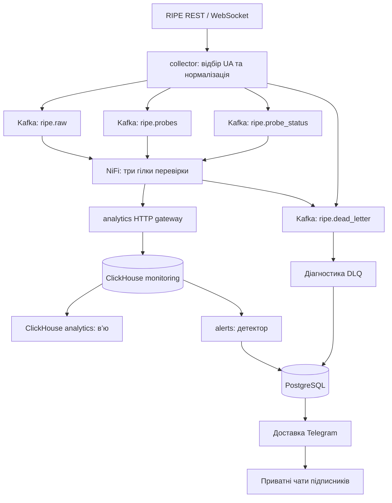

# Повний аналіз проєкту

[Карта документації](../README.md) · [Усі файли](FILES_REFERENCE.md) · [Усі об’єкти БД](DATABASE_REFERENCE.md) · [Кінцева аналітика](FINAL_ANALYTICS.md) · [Запуск](START_HERE.md)

## 1. Завдання та результат

Система спостерігає за вимірюваннями українських зондів RIPE Atlas до двох мережевих цілей. Вона приймає потік, перевіряє записи, зберігає різні рівні деталізації, розраховує KPI, фіксує інциденти й доставляє повідомлення підписникам Telegram. Результат поточного етапу — серверний конвеєр, сховища та готові аналітичні в’ю. Окремий вебдашборд ще не реалізований.

Об’єкт спостереження — шлях від конкретного зонда до конкретної цілі за конкретним IP-протоколом. Кількість зондів не дорівнює кількості користувачів або абонентів провайдера. Проєкт не виконує власний ping із Docker: він отримує результати вимірювань, які робить RIPE Atlas.

## 2. Терміни та одиниці обліку

| Поняття | Що означає |
|---|---|
| Зонд | Пристрій RIPE Atlas із probe_id, країною, координатами та ASN. |
| Ціль | K-root або F-root; hostname з довідника вимірювань. |
| Measurement | Визначене RIPE вимірювання з власним ID, ціллю, протоколом і розкладом. |
| Серія / вимірювання | Один результат ping від зонда за timestamp; може містити кілька пакетів. |
| Пакет | Окремий надісланий ICMP-запит; sent і received рахують пакети. |
| Аномалія | Виконання правила за достатньо свіжими результатами. |
| Подія інциденту | Відкриття, ескалація чи повідомлення RECOVERED у monitoring_incidents. |
| Епізод | Один неперервний відомий збій до підтвердженого відновлення. |
| Outbox | Один спільний текст сповіщення про подію. |
| Доставка | Спроба надіслати цей текст конкретному Telegram-чату. |

Наприклад, дві серії по три пакети дають 2 вимірювання та 6 надісланих пакетів. Один відкритий епізод, який отримали три підписники, дає 1 епізод, 1 outbox і 3 доставки.

## 3. Архітектура та відповідальність

| Компонент | Навіщо потрібний | Що не слід йому приписувати |
|---|---|---|
| collector | RIPE-клієнт, фільтр UA, нормалізація, backfill, checkpoint | Не виконує основну аналітичну агрегацію перед Kafka. |
| Kafka | Буфер, розділення виробника/споживача, повторне читання | Не є кінцевою SQL-БД або детектором. |
| NiFi | Видимий потік, перевірка, перетворення, маршрути й черги | Не виконує сам усі добові розрахунки. |
| analytics, Python | Контрольований запис, дедуплікація, журнал, агрегація, retention | Це назва сервісу; він не є вебдашбордом. |
| ClickHouse | Вимірювання, довідник, достатні статистики й швидкі зрізи | Не містить Telegram-токенів чи підписок. |
| alerts | Детекція, поточні стани, команди та доставка | Не є обов’язковим посередником запису ping у ClickHouse. |
| PostgreSQL | Транзакційний стан епізодів та доставки | Мережевий потік спочатку сюди не записується. |
| Kafka UI / Adminer | Допоміжний огляд тем і PostgreSQL | Не є кінцевою мережею графіків KPI. |

Усі компоненти запускаються на одному Docker-хості. Kafka має replication factor 1, тому це відтворювана навчальна система, а не відмовостійкий багатовузловий кластер.

## 4. Джерела та IPv4/IPv6

| ID | Ціль | AF | Протокол | Номінальний інтервал |
|---|---|---|---|---|
| 1001 | k.root-servers.net | 4 | IPv4 | 240 с |
| 2001 | k.root-servers.net | 6 | IPv6 | 240 с |
| 1004 | f.root-servers.net | 4 | IPv4 | 240 с |
| 2004 | f.root-servers.net | 6 | IPv6 | 240 с |

Збирач при старті перевіряє, що джерело є активним ping-вимірюванням із AF 4 або 6. Перелік українських зондів завантажується через REST із пагінацією; metadata публікуються окремо. При обробці повідомлень довідник і множина UA IDs оновлюються приблизно щогодини. Це не окрема щосекундна перевірка географії кожного зонда.

ASN для IPv4 та IPv6 може відрізнятися. В агрегаті зберігається ASN, відомий при обробці події; live-view приєднує поточний довідник. Якщо зонд змінив провайдера, історичний агрегат і поточний довідник можуть закономірно відрізнятися.

## 5. Послідовність обробки одного ping

1. RIPE повертає результат із msm_id, prb_id, timestamp, af, пакетами й RTT.
2. collector відбирає зонд за множиною UA IDs.
3. models нормалізує поля, рахує loss_pct та стабільний event_id із ідентичності події. received_at не входить до ідентичності, тому REST і WebSocket можуть мати однаковий event_id.
4. Producer чекає Kafka ACK; при тимчасовій помилці повторює відправлення.
5. NiFi читає ripe.raw, перевіряє узгодженість полів, перетворює timestamp у event_time і передає JSONEachRow до analytics:8082/ingest/ping_results.
6. Шлюз перевіряє ідентичність, межі часу, дублікати та наявність довідника. Невідомий зонд викликає повтор, поки metadata наздоженуть потік; він не підмінюється довільним чужим записом.
7. Для нових подій розраховуються достатні статистики потрібної години.
8. Намір запису з фіксованими версіями зберігається у pending-ingestion.json у Docker-томі.
9. Записуються погодинні знімки та сирі рядки. Журнал видаляється після підтвердження.
10. Перевіряються добове згортання й очищення. NiFi отримує успішну HTTP-відповідь після завершення контрольованої операції.

HTTP-запити можуть об’єднуватися у пакет. Один acknowledgement означає завершення обробки, але не обов’язково нову вставку кожного рядка: дублікати й події старші 5 годин можуть бути безпечно пропущені за контрактом.

## 6. Контракти та потоки Kafka

| Тема | Виробник → споживач | Тіло / роль | Kafka retention |
|---|---|---|---|
| ripe.raw | collector → NiFi | Нормалізована серія ping, event_id, source_mode | 7 днів |
| ripe.probes | collector → NiFi | Довідник UA-зонда, ASN, координати, статус | 14 днів |
| ripe.probe_status | collector → NiFi | Подія підключення зонда | 14 днів |
| ripe.dead_letter | collector/NiFi → diagnostics | Причина, стадія та відхилений payload, коли він доступний | 30 днів |

Статус зонда не має конкретної цілі й AF. У службових погодинних/поденних записах він кодується msm_id=0 та af=0. У користувацькі мережеві KPI такі рядки не потрапляють; підключення переглядаються окремо.

Пакети перевіряються на sent>0 та 0≤rcvd≤sent. RTT повинні бути скінченними, невід’ємними, меншими за 10000 мс та впорядкованими min≤avg≤max. При rcvd=0 RTT-поля стають NULL. Невалідний запис відокремлюється; тимчасова недоступність БД спричиняє повтор, а не оголошення мережевої аварії.

## 7. Час, відновлення та гарантії

Сирі часові мітки й ключі годин — UTC. Київська зона використовується для календарної доби та відображення. Дві повторені локальні години при переході літнього часу мають різні UTC-ключі; текстовий підпис без offset не можна використовувати як унікальний ключ.

Checkpoint — кінець успішно завершеного REST-діапазону за measurement, а не найбільший timestamp одного отриманого зонда. Новий backfill перекриває попередній діапазон на 10 хвилин. За замовчуванням максимальний горизонт — 60 хвилин; старіший розрив журналюється. Система не обіцяє автоматичного відновлення всіх днів простою. Потік періодично перепідключається для узгодження з REST; atlas_error також запускає цикл відновлення.

Семантика транспорту допускає повторні повідомлення. Захист кінцевих агрегатів забезпечують event_id, один послідовний обробник із блокуванням, фіксовані версії та журнал. Це не глобальна exactly-once транзакція між Kafka, двома БД і Telegram. Не слід запускати кілька незалежних analytics-процесів, що одночасно змінюють ті самі накопичувачі: міжпроцесний distributed lock у цьому варіанті не реалізований.

## 8. Retention та добове згортання

| Рівень | Ключ | Час життя / доступність |
|---|---|---|
| Raw ping і status | Подія | Останні 5 годин |
| Hourly accumulator | UTC-година × зонд × measurement × AF × ASN | 48 годин, із захистом незбереженого дня |
| Daily accumulator | Київська дата × ті самі виміри | Безстроково |
| Довідник | Зонд / код | Поточний логічний стан |

Накопичувач години змінюється на кожну нову подію. У hourly-в’ю годину видно після її завершення. Після 04:00 за Києвом обробник підсумовує попередній день, записує daily_metrics і лише після підтвердження позначає його ревізію збереженою. Запізніла допустима подія може уточнити день новою версією.

Очищення перевіряється після заливки та фоновим обробником, який прокидається не рідше ніж приблизно раз на 15 секунд і на часових межах. SQL materialized views лише записують маркери INSERT. Вони не є самостійними часовими тригерами. Якщо БД недоступна або операція триває довго, фізичне очищення може затриматися; користувацькі raw-в’ю додатково фільтрують часовий горизонт.

Правило 5 годин не стосується Kafka або PostgreSQL. Політика автоматичного видалення інцидентів, адресатів та історії доставки в PostgreSQL окремо не задана.

## 9. Детекція й життєвий цикл

Детектор працює циклом із паузою приблизно 10 секунд плюс час виконання запитів. Для мережевих правил бере тільки source_mode=stream за останні 15 хвилин; backfill оновлює аналітику та історичну норму, але не відтворює старі тривоги як нові live-інциденти.

| Тип | Поточна умова | Що означає |
|---|---|---|
| PACKET_LOSS | Дві різні серії за 10 хв із loss>50%; остання не старша 5 хв | Повторна проблема на шляху зонда до цілі; остання втрата 100% дає critical. |
| HIGH_RTT | Дві серії вище 2×baseline+10 мс; у baseline ≥10 серій | Підвищена затримка відносно власної історії зонда/цілі/AF. |
| PROBE_DOWN | Відомий disconnect старший 120 с, немає новішого ping у зрізі | Зв’язок зонда з Atlas потребує перевірки; не доказ втрати всього Інтернету. |
| ASN_OUTAGE | ≥4 спостережувані зонди групи; проблемних >34% | Підозра для вибірки одного ASN, measurement і AF. |
| REGION_OUTAGE | ≥20 спостережуваних зондів; проблемних >25% | Підозра у вибірці UA; назва не означає класифікацію за областями. |
| PIPELINE_STALE | Немає результатів measurement новіших 15 хв | Проблема доступності даних, не автоматичний висновок про мережу. |
| RECOVERED | Нові свідчення відновлення | Завершення відповідного епізоду. |

Baseline — середня RTT серій із RTT>0 та loss≤50% приблизно за 24 години, з погодинною лівою межею та виключеною останньою хвилиною. Це середнє, не медіана й не навчена ML-модель. У новій системі для норми спочатку накопичуються дані.

Масові ping-підозри використовують підтверджену втрату пакетів; один HIGH_RTT сам по собі не робить зонд проблемним у цих частках. Для loss/high RTT відновлення потребує двох новіших нормальних серій. Для PROBE_DOWN достатньо новішого connect або ping. Відновлення масової події перевіряє збережені affected_probe_ids. Pipeline відновлюється після результату не старшого 5 хвилин.

При повторному підтвердженні вже відкритого епізоду оновлюється стан, а не створюється нова аварія кожні 10 секунд. Ескалація до critical може створити окрему подію того самого епізоду. Cooldown становить 5 хвилин для одиночних подій і 30 хвилин для масових; ключ враховує тип, measurement, AF і критичність. Облік історичних епізодів виконується за episode_id.

## 10. Доставка Telegram

Підписки працюють для приватних чатів; групова розсилка окремо не реалізована. `/start` активує адресата, `/stop` вимикає його та скасовує pending-доставки, `/status` показує підписку. Новий користувач отримує майбутні сповіщення, а не весь попередній архів.

Постановка outbox і створення доставок виконуються транзакційно. Кожен адресат має власні attempts, next_attempt_at, sent_at та message_id. Тимчасові мережеві помилки повторюються; 429 задає глобальну паузу; 403 деактивує заблокованого адресата. Невідправлені сповіщення старші 15 хвилин стають expired. Тому збій Telegram на кілька годин не гарантує доставку всього історичного архіву після відновлення.

Між фактичним Telegram send і локальним підтвердженням немає спільної транзакції. У вузькому випадку аварії після відправлення, але до запису message_id, повторне повідомлення можливе. Наявність запису інциденту не доводить доставку: для цього перевіряється telegram_deliveries.

## 11. Сильні сторони та межі реалізації

| Аспект | Реалізовано | Практична межа |
|---|---|---|
| Відтворюваність | Compose, init SQL, bootstrap, NiFi REST-конфігурація, CI | Перевірена однохостова схема; зовнішній Інтернет потрібний для образів і RIPE. |
| Якість агрегатів | Дедуплікація та достатні статистики | Середні й відсотки не можна довільно підсумовувати в BI. |
| Довга історія | Поденні підсумки не видаляються | Raw деталі старших періодів уже недоступні; percentile/jitter із сум відновити не можна. |
| Надійність | Kafka, черги, журнал шлюзу, транзакції outbox | Один хост, replication=1, без автоматичного failover. |
| Спостереження | Дві цілі та два протоколи | Вибірка зондів нерівномірна; цілі не доводять доступність усіх сервісів. |
| Стани | Відомі disconnect та епізоди переживають перезапуск | Початковий стан до початку спостереження може бути невідомий. |
| Масові status-події | Виділена службова група AF=0 | Її знаменник формується з відключень, тому не є репрезентативною часткою всіх активних зондів. Використовувати як сигнал перевірки. |
| Свіжість | Контроль останнього event_time | Не відокремлює stream від backfill і не гарантує повноту потоку. |
| Віддалений доступ | Опубліковані локальні порти | GitHub не хостить БД; доступ між різними мережами налаштовується окремо. |

Окремі напрямки розвитку: незалежний контроль усіх стадій конвеєра й DLQ-rate, точніша модель очікуваного покриття зондів, кращий знаменник status-груп, кореляція двох цілей, robust baseline, percentiles і готовий BI-дашборд. Вони не позначені як уже реалізовані можливості.

## 12. Порядок ознайомлення для захисту

Спочатку пояснити одиницю вимірювання та джерела; потім показати три гілки NiFi, відмінність ClickHouse і PostgreSQL та правила зберігання. Далі відкрити analytics.data_freshness, графік RTT/loss за ціллю й AF, і reporting.incidents. Завершити прикладом одного епізоду та окремих доставок, зазначивши межі висновків за вибіркою.
